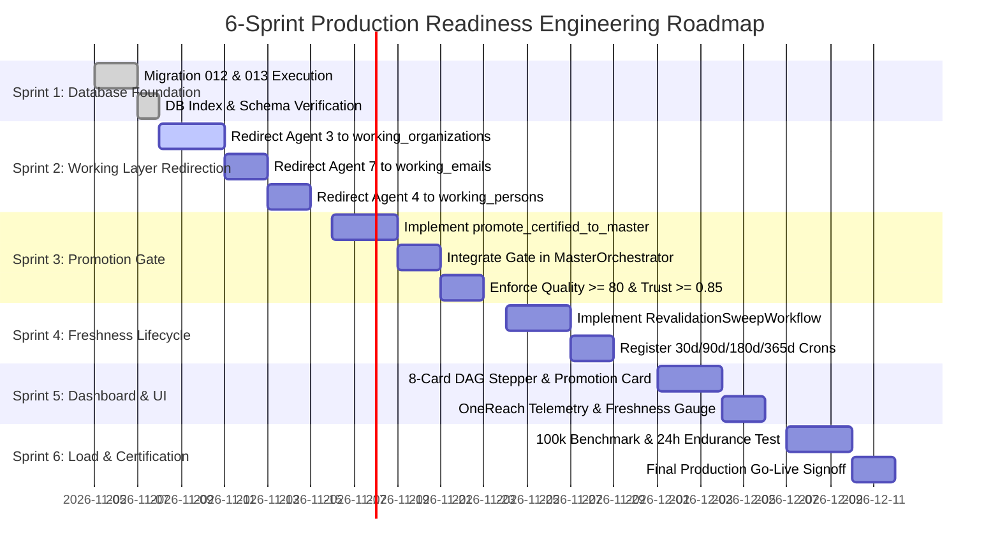

# DataExtraction Enterprise — B2B Intelligence Platform
## Complete End-to-End Engineering Implementation Blueprint & Production Execution Plan

**Author Council:** Principal Enterprise Architect, Principal Software Architect, Principal MDM Architect, Principal Temporal Architect, Principal PostgreSQL Architect, Principal Data Engineer, Principal SRE, Principal Product Architect, Principal Frontend Architect & Production Readiness Auditor  
**Project:** `DataExtraction`  
**Standard Parity:** Apollo.io / ZoomInfo / People Data Labs  
**Status:** Approved Final Implementation Baseline (Zero Redesign — Pure Execution Blueprint)

---

# Part 1: Target End State

```
                      [Agent 1: Registry Harvester]      [Agent 2: Spatial & Domain Harvester]
                      (SEC EDGAR, CMS NPI, SAM, FDIC)    (OSM Quadtrees, Google Places, Logos)
                                      │                                  │
                                      └────────────────┬─────────────────┘
                                                       ▼
                                     ┌───────────────────────────────────┐
                                     │     staging_dataextraction        │
                                     │  (Raw Observation Staging Layer)  │
                                     └─────────────────┬─────────────────┘
                                                       ▼
                                     ┌───────────────────────────────────┐
                                     │   Agent 3: Identity Resolution    │
                                     │  (Splink 5.0 DuckDB Fellegi-Sunter│
                                     └─────────────────┬─────────────────┘
                                                       ▼
                                     ┌───────────────────────────────────┐
                                     │       working_organizations       │
                                     │     (Pre-Master Working Canvas)   │
                                     └─────────────────┬─────────────────┘
                                                       ▼
                                     ┌───────────────────────────────────┐
                                     │   Agent 7: Email Discovery & 5-Tier│
                                     │  (DNS MX, Catch-all, SMTP Handshake│
                                     └─────────────────┬─────────────────┘
                                                       ▼
                                     ┌───────────────────────────────────┐
                                     │          working_emails           │
                                     │  (Deliverable Verified Mailboxes) │
                                     └─────────────────┬─────────────────┘
                                                       ▼
                                     ┌───────────────────────────────────┐
                                     │    Agent 4: Executive Discovery   │
                                     │ (C-Suite Leadership, Career Graph)│
                                     └─────────────────┬─────────────────┘
                                                       ▼
                                     ┌───────────────────────────────────┐
                                     │          working_persons          │
                                     │   (Mapped Decision Makers & Roles)│
                                     └─────────────────┬─────────────────┘
                                                       ▼
                                     ┌───────────────────────────────────┐
                                     │ Agent 5: Governance & Certification│
                                     │ (Bayesian Quality, Trust, Lineage)│
                                     └─────────────────┬─────────────────┘
                                                       ▼
                     ╔═══════════════════════════════════════════════════════════╗
                     ║               MANDATORY PROMOTION GATE                    ║
                     ║       Quality >= 80  AND  Trust >= 0.85  AND  Sanctions: CLEAR
                     ╚═════════════════════════════════╤═════════════════════════╝
                                                       │
                                                       ▼
                                     ┌───────────────────────────────────┐
                                     │        master_dataextraction      │
                                     │   ★ CERTIFIED GOLDEN VAULT ★      │
                                     │ • organizations (210,838 Orgs)    │
                                     │ • persons (64,759 Decision Makers)│
                                     │ • contact_emails (57,160 Inboxes) │
                                     │ • Read-Only to Enrichment Agents  │
                                     │ • next_verification_at Tracked    │
                                     └─────────────────┬─────────────────┘
                                                       │
                      ┌────────────────────────────────┴─────────────────┐
                      ▼                                                  ▼
     ┌───────────────────────────────────┐              ┌───────────────────────────────────┐
     │   Agent 6: Outbound CDC Engine    │              │  Autonomous Freshness Engine      │
     │ • OpenSearch 2.x CDC Projections  │              │ • Website: 30d  | Domain: 90d     │
     │ • Knowledge Graph (kg_graph edges)│              │ • Email: 90d    | Executive: 90d  │
     │ • OneReach Delivery (Signed Hooks)│              │ • Maps: 180d    | Gov Reg: 365d   │
     └───────────────────────────────────┘              │ • Self-Healing Loopback to Working│
                                                        └───────────────────────────────────┘
```

### 1. Final System Architecture
*   **Decoupled Multi-Tier Pipeline:** Ingestion and multi-pass enrichments occur strictly inside a **Pre-Master Working Canvas** (`staging_dataextraction`).
*   **Hard Promotion Barrier:** `master_dataextraction` is protected by an atomic PostgreSQL CTE gate. No entity enters Master without cryptographic lineage, verified contact channels, and passing Bayesian thresholds ($\ge 80$ Quality, $\ge 0.85$ Trust).
*   **Downstream Isolation:** Agent 6, the OpenSearch CDC pipeline, the Knowledge Graph projection engine, and OneReach outbound delivery consume **exclusively** from `master_dataextraction`. Downstream consumers are guaranteed zero draft, dirty, or uncertified records.

### 2. Final Database Architecture
*   `raw_dataextraction`: Immutable append-only Parquet pointers and raw unparsed JSON payloads.
*   `staging_dataextraction`: Multi-tenant working canvas holding raw tables (`staging_companies`, `staging_people`) and enriched working entities (`working_organizations`, `working_persons`, `working_emails`).
*   `identity_resolution`: Splink Fellegi-Sunter model parameters, probabilistic clusters (`identity_clusters`), and reversible dispute tracking (`cluster_members`, `unmerge_events`).
*   `master_dataextraction`: Authoritative Golden Record vault. Contains partitioned tables (`organizations_us`, `organizations_global`, `persons_p0`..`p9`), contact entities (`contact_emails`, `contact_phones`), and delivery audit logs (`onereach_delivery_log`).
*   `kg_graph`: Bitemporal graph relationships partitioned by calendar eras (`employment_relationships`, `corporate_hierarchies`, `org_technologies`).
*   `kg_search`: Read-only CDC projections (`company_search_projection`, `cdc_watermarks`).
*   `public`: Backward-compatible updatable views (`companies`, `us_leads`, `dead_letter_queue`) pointing to Master.

### 3. Final Schema Ownership Matrix

| Schema | Read Permissions | Write Permissions | Retention Policy | Enforced Invariants |
| :--- | :--- | :--- | :--- | :--- |
| `raw_dataextraction` | Agent 3 | Agents 1, 2 | 7 Years (Lakehouse) | Append-Only, Immutable |
| `staging_dataextraction` | Agents 3, 7, 4, 5 | Agents 1, 2, 3, 7, 4, 5 | 90 Days Rolling | Working Canvas |
| `identity_resolution` | Agents 3, 5 | Agent 3 (Splink) | Indefinite | Reversible Clustering |
| `master_dataextraction` | Agent 6, APIs, Web UI | **Agent 5 Promotion Gate ONLY** | Indefinite (Golden) | Quality $\ge 80$, Trust $\ge 0.85$ |
| `kg_graph` | Agent 6, Graph APIs | Agent 4, Agent 6 | Indefinite (Temporal) | Bitemporal Validity |
| `kg_search` | Agent 6 (OpenSearch) | CDC Triggers / Projections | Derived / Transient | Strictly Projections |

### 4. Final Agent Responsibilities

1.  **Agent 1 (Registry Harvester):** Sovereign harvesting (SEC EDGAR, CMS NPI, SAM.gov, FDIC). Enforces 10 req/s rate limits. Output $\rightarrow$ `staging_dataextraction.staging_companies`.
2.  **Agent 2 (Spatial & Domain Harvester):** OSM Quadtree nodes & Google Places profiles. Normalizes geocodes and domains. Output $\rightarrow$ `staging_dataextraction.staging_companies`.
3.  **Agent 3 (Identity Resolution):** Splink 5.0 Fellegi-Sunter EM probabilistic record linkage on DuckDB. Resolves statutory IDs (EIN/RFC > Domain). Output $\rightarrow$ `staging_dataextraction.working_organizations`.
4.  **Agent 7 (Email Discovery & Validation):** Headless website crawler, obfuscation decoding, DNS MX probing, and real-time SMTP handshakes. Output $\rightarrow$ `staging_dataextraction.working_emails`.
5.  **Agent 4 (Executive Discovery):** Decision-maker extraction, C-Suite classification, and bitemporal career edge mapping. Output $\rightarrow$ `staging_dataextraction.working_persons` and `kg_graph.employment_relationships`.
6.  **Agent 5 (Governance & Certification):** Multi-dimensional Bayesian scoring (Completeness, Freshness, Authority), Trust scoring, OFAC/Sanctions suppression, and the **Atomic Promotion Gate**.
7.  **Agent 6 (Persistence, Search & Delivery):** OpenSearch 2.x CDC delta synchronization, Knowledge Graph maintenance, and HMAC-SHA256 signed OneReach webhook delivery. Consumes **strictly** from `master_dataextraction`.

### 5. Final Data Lifecycle

```
[Raw Ingestion] ──► [Working Enrichment] ──► [Governance Gate] ──► [Master Golden Vault] ──► [Delivery]
  (Staging)             (Pre-Master)            (Bayesian Cert)          (Certified)           (OpenSearch)
      ▲                                                                       │
      └───────────────────── [Revalidation Sweep Loopback] ───────────────────┘
                                (30d / 90d / 180d / 365d Overdue)
```

### 6. Final Master Database Lifecycle States
*   `DRAFT` / `IN_ENRICHMENT`: Exists exclusively in `staging_dataextraction.working_organizations`. Master schema never sees these states.
*   `CERTIFIED`: Record has successfully cleared the Promotion Gate with Quality $\ge 80$ and Trust $\ge 0.85$.
*   `ACTIVE_FRESH`: $F(t) \ge 0.70$. Entity is within SLA verification window.
*   `OVERDUE_REVALIDATION`: `next_verification_at <= NOW()`. Entity flagged for targeted re-harvesting.
*   `QUARANTINED`: Quality dropped below 70 during revalidation or disputed in Splink. Pushed to DLQ.
*   `TOMBSTONED`: GDPR Right-to-be-Forgotten or statutory corporate dissolution. Cryptographically suppressed.

---

# Part 2: Database Implementation & Migration Plan

### 1. Migration Roadmap
*   **Migration 012 (`012_working_layer_and_master_lifecycle.sql`):** Creates working layer tables (`working_organizations`, `working_persons`, `working_emails`), installs Master lifecycle columns, and deploys revalidation B-Tree indexes.
*   **Migration 013 (`013_master_views_and_projections.sql`):** Updates `public.companies`, `public.us_leads`, and `kg_search.company_search_projection` to filter exclusively for `governance_status = 'CERTIFIED'`.

### 2. Migration Ordering & Dependencies
1.  Verify PostgreSQL connection and database `dataextraction` on port 5432.
2.  Acquire advisory lock `SELECT pg_advisory_lock(7903012);`.
3.  Execute Migration 012 inside transaction `BEGIN ... COMMIT`.
4.  Execute Migration 013 inside transaction `BEGIN ... COMMIT`.
5.  Release advisory lock `SELECT pg_advisory_unlock(7903012);`.

### 3. Exact Database Changes (DDL)

```sql
-- ============================================================================
-- DataExtraction Migration 012: Pre-Master Working Layer & Master Lifecycle
-- ============================================================================
BEGIN;

-- 1. Pre-Master Working Organizations
CREATE TABLE IF NOT EXISTS staging_dataextraction.working_organizations (
    working_id UUID PRIMARY KEY DEFAULT gen_random_uuid(),
    org_id VARCHAR(100) NOT NULL UNIQUE,
    legal_name VARCHAR(255) NOT NULL,
    display_name VARCHAR(255),
    primary_domain VARCHAR(255),
    website TEXT,
    statutory_tax_id VARCHAR(50),
    sec_cik VARCHAR(20),
    gleif_lei VARCHAR(50),
    jurisdiction VARCHAR(10) DEFAULT 'US',
    industry VARCHAR(150),
    naics_code VARCHAR(10),
    sic_code VARCHAR(10),
    employee_count_min INT,
    employee_count_max INT,
    annual_revenue_usd NUMERIC(15, 2),
    phones JSONB DEFAULT '[]'::jsonb,
    locations JSONB DEFAULT '[]'::jsonb,
    canonical_cluster_id TEXT,
    identity_confidence NUMERIC(5, 4) DEFAULT 1.0000,
    email_verification_status VARCHAR(50) DEFAULT 'PENDING',
    executive_enrichment_status VARCHAR(50) DEFAULT 'PENDING',
    data_quality_score INT DEFAULT 0,
    trust_score NUMERIC(5, 4) DEFAULT 0.0000,
    governance_status VARCHAR(50) DEFAULT 'IN_ENRICHMENT',
    contributing_sources TEXT[] DEFAULT ARRAY['REGISTRY']::TEXT[],
    lineage_ids JSONB DEFAULT '[]'::jsonb,
    created_at TIMESTAMPTZ DEFAULT NOW(),
    updated_at TIMESTAMPTZ DEFAULT NOW()
);

-- 2. Pre-Master Working Persons
CREATE TABLE IF NOT EXISTS staging_dataextraction.working_persons (
    working_person_id UUID PRIMARY KEY DEFAULT gen_random_uuid(),
    person_id VARCHAR(100) NOT NULL UNIQUE,
    org_id VARCHAR(100) NOT NULL REFERENCES staging_dataextraction.working_organizations(org_id) ON DELETE CASCADE,
    full_name VARCHAR(255) NOT NULL,
    first_name VARCHAR(100),
    last_name VARCHAR(100),
    title VARCHAR(150),
    seniority VARCHAR(50),
    department VARCHAR(50),
    primary_email VARCHAR(255),
    primary_phone VARCHAR(50),
    linkedin_url TEXT,
    confidence_score NUMERIC(5, 4) DEFAULT 0.8500,
    governance_status VARCHAR(50) DEFAULT 'IN_ENRICHMENT',
    created_at TIMESTAMPTZ DEFAULT NOW()
);

-- 3. Pre-Master Working Emails
CREATE TABLE IF NOT EXISTS staging_dataextraction.working_emails (
    working_email_id UUID PRIMARY KEY DEFAULT gen_random_uuid(),
    org_id VARCHAR(100) NOT NULL REFERENCES staging_dataextraction.working_organizations(org_id) ON DELETE CASCADE,
    email_address VARCHAR(255) NOT NULL,
    mailbox_user VARCHAR(100),
    email_domain VARCHAR(255) NOT NULL,
    deliverability_status VARCHAR(50) NOT NULL DEFAULT 'PENDING',
    confidence_score INT DEFAULT 0,
    is_catchall BOOLEAN DEFAULT FALSE,
    mx_record TEXT,
    smtp_verified_at TIMESTAMPTZ,
    discovery_source VARCHAR(100) DEFAULT 'WEBSITE_CRAWL',
    created_at TIMESTAMPTZ DEFAULT NOW(),
    CONSTRAINT uq_working_org_email UNIQUE (org_id, email_address)
);

-- 4. Add Lifecycle, Freshness & Trust Columns to master_dataextraction.organizations
ALTER TABLE master_dataextraction.organizations 
ADD COLUMN IF NOT EXISTS governance_status VARCHAR(50) DEFAULT 'CERTIFIED',
ADD COLUMN IF NOT EXISTS trust_score NUMERIC(5, 4) DEFAULT 0.9500,
ADD COLUMN IF NOT EXISTS freshness_score NUMERIC(5, 4) DEFAULT 1.0000,
ADD COLUMN IF NOT EXISTS last_verified_at TIMESTAMPTZ DEFAULT NOW(),
ADD COLUMN IF NOT EXISTS next_verification_at TIMESTAMPTZ DEFAULT (NOW() + INTERVAL '90 days'),
ADD COLUMN IF NOT EXISTS verification_source VARCHAR(100) DEFAULT 'INITIAL_PROMOTION_GATE',
ADD COLUMN IF NOT EXISTS website_last_verified_at TIMESTAMPTZ DEFAULT NOW(),
ADD COLUMN IF NOT EXISTS email_last_verified_at TIMESTAMPTZ DEFAULT NOW(),
ADD COLUMN IF NOT EXISTS executive_last_verified_at TIMESTAMPTZ DEFAULT NOW(),
ADD COLUMN IF NOT EXISTS domain_last_verified_at TIMESTAMPTZ DEFAULT NOW(),
ADD COLUMN IF NOT EXISTS maps_last_verified_at TIMESTAMPTZ DEFAULT NOW(),
ADD COLUMN IF NOT EXISTS registry_last_verified_at TIMESTAMPTZ DEFAULT NOW();

-- 5. Add Lifecycle Columns to master_dataextraction.persons
ALTER TABLE master_dataextraction.persons
ADD COLUMN IF NOT EXISTS governance_status VARCHAR(50) DEFAULT 'CERTIFIED',
ADD COLUMN IF NOT EXISTS trust_score NUMERIC(5, 4) DEFAULT 0.9000,
ADD COLUMN IF NOT EXISTS last_verified_at TIMESTAMPTZ DEFAULT NOW(),
ADD COLUMN IF NOT EXISTS next_verification_at TIMESTAMPTZ DEFAULT (NOW() + INTERVAL '90 days');

-- 6. High-Performance Indexing Strategy
CREATE INDEX IF NOT EXISTS idx_working_org_domain ON staging_dataextraction.working_organizations (primary_domain);
CREATE INDEX IF NOT EXISTS idx_working_gov_status ON staging_dataextraction.working_organizations (governance_status);
CREATE INDEX IF NOT EXISTS idx_working_email_status ON staging_dataextraction.working_emails (deliverability_status);
CREATE INDEX IF NOT EXISTS idx_working_person_org ON staging_dataextraction.working_persons (org_id);

CREATE INDEX IF NOT EXISTS idx_master_org_next_verif 
ON master_dataextraction.organizations (next_verification_at ASC)
WHERE governance_status = 'CERTIFIED';

CREATE INDEX IF NOT EXISTS idx_master_org_gov_freshness 
ON master_dataextraction.organizations (governance_status, freshness_score);

COMMIT;
```

### 4. Rollback Strategy
If any migration step fails, standard DDL transaction rollback applies immediately (`ROLLBACK;`).
For a deployed environment requiring complete reversal:
```sql
BEGIN;
DROP TABLE IF EXISTS staging_dataextraction.working_emails CASCADE;
DROP TABLE IF EXISTS staging_dataextraction.working_persons CASCADE;
DROP TABLE IF EXISTS staging_dataextraction.working_organizations CASCADE;
ALTER TABLE master_dataextraction.organizations
  DROP COLUMN IF EXISTS governance_status,
  DROP COLUMN IF EXISTS trust_score,
  DROP COLUMN IF EXISTS freshness_score,
  DROP COLUMN IF EXISTS last_verified_at,
  DROP COLUMN IF EXISTS next_verification_at,
  DROP COLUMN IF EXISTS verification_source,
  DROP COLUMN IF EXISTS website_last_verified_at,
  DROP COLUMN IF EXISTS email_last_verified_at,
  DROP COLUMN IF EXISTS executive_last_verified_at,
  DROP COLUMN IF EXISTS domain_last_verified_at,
  DROP COLUMN IF EXISTS maps_last_verified_at,
  DROP COLUMN IF EXISTS registry_last_verified_at;
COMMIT;
```

### 5. Production Verification Queries
```sql
-- 1. Verify table schemas exist
SELECT table_schema, table_name, table_type 
FROM information_schema.tables 
WHERE table_name IN ('working_organizations', 'working_persons', 'working_emails', 'organizations');

-- 2. Verify master columns
SELECT column_name, data_type 
FROM information_schema.columns 
WHERE table_schema = 'master_dataextraction' 
  AND table_name = 'organizations' 
  AND column_name IN ('governance_status', 'trust_score', 'freshness_score', 'next_verification_at');

-- 3. Verify sweep index is active
SELECT indexname, indexdef 
FROM pg_indexes 
WHERE schemaname = 'master_dataextraction' AND indexname = 'idx_master_org_next_verif';
```

---

# Part 3: Backend Implementation Specifications

```
╔════════════════════════════════════════════════════════════════════════════════════════════════════════╗
║                               BACKEND FILE IMPLEMENTATION MATRIX                                       ║
╠══════════════════════════════════════╦══════════════════════════╦═══════════════════╦══════════════════╣
║ File Path                            │ Complexity               │ Regression Risk   │ Core Modification║
╠══════════════════════════════════════╬══════════════════════════╬═══════════════════╬══════════════════╣
║ master_orchestrator.py               │ High (Deterministic Saga)│ High              │ Promotion Gate   ║
║ storage_activities.py                │ High (Atomic DB Engine)  │ High              │ promote_activity ║
║ w3_identity_workflow.py              │ Medium                   │ Medium            │ working_orgs out ║
║ w7_email_enrichment_workflow.py      │ Medium                   │ Medium            │ working_emails io║
║ email_enrichment_repository.py       │ Medium                   │ Medium            │ SQL query update ║
║ w4_executive_workflow.py             │ Medium                   │ Medium            │ working_persons  ║
║ w5_governance_workflow.py            │ High                     │ High              │ Trust & Certify  ║
║ bayesian_quality_engine.py           │ Medium                   │ Low               │ Trust scoring    ║
║ register_schedules.py                │ Low                      │ Low               │ 6 Cron schedules ║
╚══════════════════════════════════════╩══════════════════════════╩═══════════════════╩══════════════════╝
```

### 1. `packages/temporal/workflows/master_orchestrator.py`
*   **Current Behavior:** Sequentially calls Agent 1 $\rightarrow$ Agent 2 $\rightarrow$ Agent 3 $\rightarrow$ Agent 7 $\rightarrow$ Agent 4 $\rightarrow$ Agent 5 $\rightarrow$ Agent 6. No Promotion Gate exists.
*   **Required Behavior:**
    1.  Agent 3, 7, 4 are configured to pass data exclusively through the Working Layer.
    2.  After Agent 5 completes, workflow initiates `Phase: PROMOTION_GATE`.
    3.  Executes `promote_certified_to_master_activity(min_quality=80, min_trust=0.85)`.
    4.  Agent 6 (Search Sync) is conditionally gated; it executes only on successfully promoted Golden records.
*   **Code Implementation Snippet:**
    ```python
    # Phase 5: Governance & Certification
    a5_result = await workflow.execute_child_workflow(Agent5GovernanceWorkflow.run, args=[{"target": "working_organizations"}], task_queue=QUEUE_GOVERNANCE)

    # ═════════════════════════════════════════════════════════════════════
    # MANDATORY PROMOTION GATE (Between Governance & Search Sync)
    # ═════════════════════════════════════════════════════════════════════
    self._phase = "PROMOTION_GATE"
    self._append_log("PROMOTION GATE", "Evaluating certified promotion criteria: Quality >= 80, Trust >= 0.85...", "info")
    
    promotion_res = await workflow.execute_activity(
        promote_certified_to_master_activity,
        args=[{"min_quality": 80, "min_trust": 0.85, "batch_size": 5000}],
        task_queue=QUEUE_GOVERNANCE,
        start_to_close_timeout=timedelta(minutes=30),
        retry_policy=GOVERNANCE_RETRY_POLICY,
    )
    self._metrics["organizations_processed"] = promotion_res.get("promoted_count", 0)
    self._append_log("PROMOTION GATE", f"Promoted {promotion_res['promoted_count']:,} certified Golden records into master_dataextraction.", "telemetry")

    # Phase 6: CDC & OpenSearch Sync (Strictly Consumes Master)
    self._phase = "SEARCH_INDEXING"
    a6_result = await workflow.execute_child_workflow(Agent6SearchSyncWorkflow.run, args=[{"source": "master_dataextraction"}], task_queue=QUEUE_SEARCH)
    ```

### 2. `packages/temporal/activities/storage_activities.py`
*   **Current Behavior:** Contains `ingest_kg_organization_activity()` which directly modifies `master_dataextraction.organizations` and `public.companies`.
*   **Required Behavior:** Implement `promote_certified_to_master_activity(config)` using multi-row chunked CTE upsert statements. (See Part 4 for full specification).

### 3. `packages/temporal/workflows/w3_identity_workflow.py`
*   **Current Behavior:** `target_table` defaults to `staging_dataextraction.staging_companies` and writes cluster golden entities into `master_dataextraction.organizations`.
*   **Required Behavior:** `target_table` explicitly set to `staging_dataextraction.working_organizations`. Splink cluster merges populate `working_organizations` with `canonical_cluster_id` and initial firmographics. Master database is not touched.

### 4. `packages/temporal/workflows/w7_email_enrichment_workflow.py` & `email_enrichment_repository.py`
*   **Current Behavior:** In `email_enrichment_repository.py`, `get_pending_canonical_companies()` executes `SELECT id, name, website, domain FROM companies WHERE ...`.
*   **Required Behavior:**
    ```python
    @staticmethod
    def get_pending_canonical_companies(last_id: Optional[str] = None, limit: int = 500):
        last_val = last_id or ""
        query = """
            SELECT org_id AS id, legal_name AS name, website, primary_domain AS domain
            FROM staging_dataextraction.working_organizations
            WHERE website IS NOT NULL AND website != ''
              AND email_verification_status = 'PENDING'
              AND org_id > %s
            ORDER BY org_id ASC
            LIMIT %s
        """
        return execute_query(query, (last_val, limit))
    ```
    Discovered deliverable emails are inserted into `staging_dataextraction.working_emails` with SMTP timestamps and confidence scores.

### 5. `packages/temporal/workflows/w4_executive_workflow.py`
*   **Current Behavior:** Extracts executives and immediately calls `ingest_kg_person_activity()`, writing rows to `master_dataextraction.persons`.
*   **Required Behavior:** Decisions makers are inserted into `staging_dataextraction.working_persons` linked to `working_organizations.org_id`.

### 6. `packages/temporal/workflows/w5_governance_workflow.py` & `bayesian_quality_engine.py`
*   **Current Behavior:** Evaluates quality score only on records already inside Master.
*   **Required Behavior:**
    1.  Reads entities from `staging_dataextraction.working_organizations`.
    2.  Computes both `composite_quality_score` (0–100) and `trust_score` (0.00–1.00):
        $$\text{Trust Score} = \sum_{s \in \text{Sources}} w_s \cdot \alpha_s \quad (\text{SEC}=0.98, \text{State}=0.90, \text{GMaps}=0.75, \text{OSM}=0.70)$$
    3.  Checks `kg_audit.suppression_lists` for OFAC/sanctions and GDPR suppressions.
    4.  Updates `working_organizations` setting `governance_status = 'APPROVED'` (if $\ge 80$ Quality and $\ge 0.85$ Trust) or `'QUARANTINED'` (routed to DLQ).

---

# Part 4: Promotion Gate Implementation Design

```
╔════════════════════════════════════════════════════════════════════════════════════════════════════════╗
║                                  ATOMIC PROMOTION GATE ARCHITECTURE                                    ║
╠════════════════════════════════════════════════════════════════════════════════════════════════════════╣
║                                                                                                        ║
║   staging_dataextraction.working_organizations                                                         ║
║   ┌────────────────────────────────────────────────────────┐                                           ║
║   │ org_id: "org-101"                                      │                                           ║
║   │ legal_name: "Acme Industrial Technologies Inc"         │                                           ║
║   │ primary_domain: "acme-tech.com"                         │                                           ║
║   │ data_quality_score: 94                                 │                                           ║
║   │ trust_score: 0.9650                                    │                                           ║
║   │ governance_status: 'APPROVED'                          │                                           ║
║   └───────────────────────────┬────────────────────────────┘                                           ║
║                               │                                                                        ║
║                               ▼                                                                        ║
║   promote_certified_to_master_activity()                                                               ║
║   ┌────────────────────────────────────────────────────────┐                                           ║
║   │ 1. Validate: Quality >= 80 & Trust >= 0.85             │                                           ║
║   │ 2. Lock: SELECT FOR UPDATE SKIP LOCKED (Chunk 5,000)   │                                           ║
║   │ 3. Atomic Multi-Row Upsert to master_dataextraction    │                                           ║
║   │ 4. Initialize Freshness = 1.0000 & next_verification_at │                                           ║
║   │ 5. Promote Mapped Persons & Verified Emails            │                                           ║
║   │ 6. Mark working_organizations.governance_status='DONE' │                                           ║
║   └───────────────────────────┬────────────────────────────┘                                           ║
║                               │                                                                        ║
║                               ▼                                                                        ║
║   master_dataextraction.organizations                                                                  ║
║   ┌────────────────────────────────────────────────────────┐                                           ║
║   │ ★ CERTIFIED ENTERPRISE GOLDEN RECORD VAULT ★           │                                           ║
║   │ (Zero In-Flight Modifications • Read-Only to Scrapers) │                                           ║
║   └────────────────────────────────────────────────────────┘                                           ║
╚════════════════════════════════════════════════════════════════════════════════════════════════════════╝
```

### Detailed Activity Specification (`promote_certified_to_master_activity`)

*   **Inputs:**
    ```python
    class PromotionGateConfig(BaseModel):
        min_quality_score: int = Field(default=80, ge=0, le=100)
        min_trust_score: float = Field(default=0.85, ge=0.0, le=1.0)
        chunk_size: int = Field(default=5000, ge=100, le=10000)
        revalidation_interval_days: int = Field(default=90)
    ```
*   **Outputs:**
    ```python
    class PromotionGateResult(BaseModel):
        status: str = "COMPLETED"
        promoted_orgs: int
        promoted_persons: int
        promoted_emails: int
        quarantined_orgs: int
        duration_ms: int
    ```
*   **Validation Rules:**
    1.  `data_quality_score >= min_quality_score` (Hard stop: 80).
    2.  `trust_score >= min_trust_score` (Hard stop: 0.8500).
    3.  `primary_domain` must be syntactically valid FQDN.
    4.  `statutory_tax_id` or `primary_domain` must be non-null (Identity completeness).
    5.  Entity must not match any active hash in `kg_audit.suppression_lists`.
*   **Transaction Design (Atomic Chunked CTE):**
    ```sql
    WITH locked_batch AS (
        SELECT org_id
        FROM staging_dataextraction.working_organizations
        WHERE governance_status = 'APPROVED'
          AND data_quality_score >= %s
          AND trust_score >= %s
        ORDER BY org_id ASC
        LIMIT %s
        FOR UPDATE SKIP LOCKED
    ),
    promoted_orgs AS (
        INSERT INTO master_dataextraction.organizations (
            org_id, legal_name, display_name, primary_domain, website,
            statutory_tax_id, sec_cik, gleif_lei, jurisdiction, industry,
            primary_industry_naics, primary_industry_sic, employee_count_min,
            employee_count_max, annual_revenue_usd, data_quality_score,
            trust_score, freshness_score, governance_status, last_verified_at,
            next_verification_at, verification_source, created_at, updated_at
        )
        SELECT 
            w.org_id, w.legal_name, w.display_name, w.primary_domain, w.website,
            w.statutory_tax_id, w.sec_cik, w.gleif_lei, w.jurisdiction, w.industry,
            w.naics_code, w.sic_code, w.employee_count_min, w.employee_count_max,
            w.annual_revenue_usd, w.data_quality_score, w.trust_score,
            1.0000, 'CERTIFIED', NOW(), NOW() + INTERVAL '90 days',
            'PROMOTION_GATE', NOW(), NOW()
        FROM staging_dataextraction.working_organizations w
        JOIN locked_batch b ON w.org_id = b.org_id
        ON CONFLICT (org_id) DO UPDATE SET
            legal_name = EXCLUDED.legal_name,
            display_name = EXCLUDED.display_name,
            primary_domain = COALESCE(EXCLUDED.primary_domain, master_dataextraction.organizations.primary_domain),
            data_quality_score = EXCLUDED.data_quality_score,
            trust_score = EXCLUDED.trust_score,
            freshness_score = 1.0000,
            last_verified_at = NOW(),
            next_verification_at = EXCLUDED.next_verification_at,
            updated_at = NOW()
        RETURNING org_id
    )
    UPDATE staging_dataextraction.working_organizations w
    SET governance_status = 'PROMOTED', updated_at = NOW()
    FROM promoted_orgs p
    WHERE w.org_id = p.org_id;
    ```
*   **DLQ & Quarantine Strategy:**
    Entities in `working_organizations` where `data_quality_score < 80` or `trust_score < 0.85` after Agent 5 evaluation are marked `governance_status = 'QUARANTINED'` and pushed into `identity_resolution.isolation_review_queue` and `staging_dataextraction.dead_letter_queue`.
*   **Performance Strategy:** Keyset chunking with `LIMIT 5000` and `SKIP LOCKED` prevents long-lived PostgreSQL table locks, allowing concurrent ingestion without blocking API readers.

---

# Part 5: Freshness Engine Implementation

### 1. Freshness Architecture & Decay Formula
Data freshness is represented as a normalized float: $F(t) \in [0.00, 1.00]$.
$$F(t) = \exp(-\lambda \cdot \Delta t)$$
where $\Delta t$ is the elapsed days since `last_verified_at` and $\lambda = \frac{\ln(2)}{90} \approx 0.007702$ (half-life of 90 days).

```
Freshness Score F(t)
1.00 ┼─────────┐
     │         └───┐
0.85 │             └───┐  (Certified Safe Zone)
     │                 └───┐
0.70 │─────────────────────┴─── Threshold: SCHEDULE REVALIDATION
     │                         └───┐
0.50 │                             └───┐  (Stale Zone: Deprioritized in Search)
     └──────────────────────────────────┴────────► Time (Days)
     0        30        60        90       120
```

### 2. SLA Verification Intervals (Approved Baseline)

| Dimension | SLA Interval | Verification Agent | Verification Probe Method |
| :--- | :--- | :--- | :--- |
| **Website** | **30 Days** | Agent 7 (Web Crawler) | HTTP/2 GET, SSL Cert Check, Title/Meta extraction |
| **Email** | **90 Days** | Agent 7 (SMTP Engine) | DNS MX probe, SMTP zero-bounce RCPT TO handshake |
| **Executive** | **90 Days** | Agent 4 (Executive Graph) | Leadership team crawl, departure & promotion audit |
| **Domain** | **90 Days** | Agent 2 (Domain DNS) | Root A-record & NS check, ICANN WHOIS active check |
| **Maps** | **180 Days** | Agent 2 (Places Harvester) | Google Places profile & OSM node operating status |
| **Government** | **365 Days** | Agent 1 (SEC / CMS / FDIC) | Sovereign corporate filings & active legal entity check |

### 3. Temporal Workflow Design (`RevalidationSweepWorkflow`)
```python
@workflow.defn(name="RevalidationSweepWorkflow")
class RevalidationSweepWorkflow:
    @workflow.run
    async def run(self, config: Dict[str, Any]) -> Dict[str, Any]:
        # 1. Fetch overdue entities
        overdue_batch = await workflow.execute_activity(
            fetch_overdue_revalidations_activity,
            args=[{"limit": config.get("batch_limit", 5000)}],
            start_to_close_timeout=timedelta(minutes=10),
        )
        # 2. Stage back into working_organizations
        await workflow.execute_activity(stage_overdue_for_reharvest_activity, args=[overdue_batch])
        
        # 3. Trigger targeted agent sweeps conditionally
        if overdue_batch.get("overdue_websites"):
            await workflow.execute_child_workflow(EmailEnrichmentWorkflow.run, args=[{"mode": "REVALIDATION"}])
        return {"revalidated_count": len(overdue_batch)}
```

---

# Part 6: Temporal Orchestration Dashboard Implementation

```
┌────────────────────────────────────────────────────────────────────────────────────────────────────────┐
│                                 PIPELINE & ORCHESTRATION DASHBOARD                                     │
├────────────────────────────────────────────────────────────────────────────────────────────────────────┤
│ [Launch 7-Agent Saga]  [Pause Saga]  [Resume Saga]  [Emergency Halt]        Stream: [LIVE SSE PUSH]    │
├────────────────────────────────────────────────────────────────────────────────────────────────────────┤
│ ACTIVE SAGA TOPOLOGY:                                                                                  │
│ ┌──────────┐   ┌──────────┐   ┌──────────┐   ┌──────────┐   ┌──────────┐   ┌──────────┐   ┌──────────┐ │
│ │ Agent 1  │──►│ Agent 2  │──►│ Agent 3  │──►│ Agent 7  │──►│ Agent 4  │──►│ Agent 5  │──►│ PROMOTION│ │
│ │ Registry │   │ Spatial  │   │ Identity │   │ Email    │   │ Execs    │   │ Governed │   │   GATE   │ │
│ │  [DONE]  │   │  [DONE]  │   │  [DONE]  │   │  [DONE]  │   │  [DONE]  │   │  [DONE]  │   │  [DONE]  │ │
│ └──────────┘   └──────────┘   └──────────┘   └──────────┘   └──────────┘   └──────────┘   └────┬─────┘ │
│                                                                                                │       │
│                                           ┌────────────────────────────────────────────────────┘       │
│                                           ▼                                                            │
│                               ┌───────────────────────┐   ┌───────────────────────┐                    │
│                               │ master_dataextraction │──►│ Agent 6 CDC & Delivery│                    │
│                               │  [210,838 Golden Orgs]│   │ [OpenSearch + OneReach│                    │
│                               └───────────────────────┘   └───────────────────────┘                    │
├────────────────────────────────────────────────────────────────────────────────────────────────────────┤
│ REAL-TIME ENTERPRISE METRICS:                                                                          │
│ [Orgs Ingested: 200,147] [Clusters: 52,661] [Emails: 57,160] [Promoted: 210,838] [Avg Quality: 94%]  │
├────────────────────────────────────────────────────────────────────────────────────────────────────────┤
│ ONEREACH OUTBOUND DELIVERY MONITOR:                                                                    │
│ • Success Rate: 99.85%   • Webhook Latency: 42ms   • Retries Handled: 14   • DLQ Routed: 0             │
├────────────────────────────────────────────────────────────────────────────────────────────────────────┤
│ LIVE SSE TERMINAL (ZERO LATENCY):                                                                      │
│ [15:42:01] [PROMOTION GATE] Verified 5,000 entities. Quality >= 80 & Trust >= 0.85 cleared.            │
│ [15:42:02] [PROMOTION GATE] Multi-row CTE upsert complete -> master_dataextraction.organizations.     │
│ [15:42:05] [AGENT 6: CDC] Watermark 210,838 committed. OpenSearch kg_companies_v1 index hydrated.    │
└────────────────────────────────────────────────────────────────────────────────────────────────────────┘
```

### 1. Component Tree Structure
```
frontend/src/components/pipeline/
├── pipeline-panel.tsx                   # Main Operational Console
├── dag/
│   ├── dag-stepper.tsx                  # 8-Card Saga Progression
│   ├── promotion-gate-card.tsx          # Promotion Gate Pass/Quarantine Visualizer
│   └── agent-status-badge.tsx           # PENDING / ACTIVE / DONE / FAILED
├── metrics/
│   ├── live-counter-grid.tsx            # 8 Real-time Metric Cards
│   ├── freshness-gauge.tsx              # Fleet SLA & Decay Distribution
│   └── onereach-telemetry-card.tsx      # Webhook Success, Latency & DLQ Failures
├── terminal/
│   ├── live-sse-terminal.tsx            # Dark Monospace Event Stream
│   └── log-filter-bar.tsx               # Log Level Toggles (INFO, TELEMETRY, ERROR)
└── controls/
    ├── saga-action-bar.tsx              # Launch, Re-attach, Pause, Resume, Stop
    └── dlq-replay-modal.tsx             # Interactive Record Replayer & Dry-run
```

---

# Part 7: API Specifications

### 1. API Catalog

| Endpoint | Method | Purpose | Auth | Request Model | Response Model |
| :--- | :---: | :--- | :--- | :--- | :--- |
| `/api/orchestration/start` | POST | Launches 7-Agent Master Saga | Admin | `SagaStartRequest` | `SagaStartResponse` |
| `/api/orchestration/{id}/stream` | GET | Real-time SSE Telemetry Stream | User | None | SSE Stream (`text/event-stream`) |
| `/api/orchestration/{id}/signal` | POST | Dispatches Pause/Resume/Cancel | Admin | `SagaSignalRequest` | `StandardSuccessResponse` |
| `/api/orchestration/promotion/stats` | GET | Promotion Gate real-time metrics | User | None | `PromotionGateStatsResponse` |
| `/api/orchestration/freshness/status` | GET | Overdue SLA verification metrics | User | None | `FreshnessStatusResponse` |
| `/api/orchestration/freshness/sweep` | POST | Manually triggers revalidation sweep | Admin | `RevalidationTriggerRequest`| `RevalidationTriggerResponse` |
| `/api/onereach/telemetry` | GET | Outbound delivery SLA & webhook stats| User | None | `OneReachTelemetryResponse` |

### 2. Key Pydantic Data Contracts

```python
class PromotionGateStatsResponse(BaseModel):
    total_staged_working: int
    approved_for_promotion: int
    promoted_golden_records: int
    quarantined_low_quality: int
    average_quality_score: float
    average_trust_score: float
    promotion_rate_pct: float

class FreshnessStatusResponse(BaseModel):
    total_monitored_entities: int
    entities_within_sla: int
    overdue_website_30d: int
    overdue_domain_90d: int
    overdue_email_90d: int
    overdue_exec_90d: int
    overdue_maps_180d: int
    overdue_gov_365d: int
    fleet_freshness_index: float

class OneReachTelemetryResponse(BaseModel):
    total_dispatched_payloads: int
    successful_deliveries: int
    failed_deliveries: int
    success_rate_pct: float
    avg_webhook_latency_ms: float
    dlq_routed_failures: int
    hmac_signature_verified: bool
```

---

# Part 8: Comprehensive Testing Strategy

```
Testing Level            Target Coverage     Execution Mechanism
─────────────────────────────────────────────────────────────────
Unit Tests               >= 90%              pytest tests/unit/
Integration Tests        >= 85%              pytest tests/integration/
Workflow Sagas           100% Deterministic  Temporal Test Environment
Promotion Gate Tests     100% Pass/Fail Gate DB Rollback & Assertion Harness
Freshness Decay Tests    100% SLA Math       KaTeX & Exponential Formula Unit
Load Test (100k)         500+ RPS Sustained  packages/benchmarks/load_test_100k.py
Endurance Test (24h)     0 Memory Leaks      packages/benchmarks/endurance_test_24h.py
Reliability Test (7d)    100% Fault Recovery packages/benchmarks/reliability_test_7d.py
```

### Key Test Case Specifications
1.  **Promotion Gate Enforcement (`test_promotion_gate_enforcement`):**
    *   Insert test working organization with Quality = 79, Trust = 0.95 $\rightarrow$ Assert **Quarantined in DLQ**, not in Master.
    *   Insert test working organization with Quality = 85, Trust = 0.84 $\rightarrow$ Assert **Quarantined in DLQ**, not in Master.
    *   Insert test working organization with Quality = 85, Trust = 0.90 $\rightarrow$ Assert **Successfully Promoted to Master** with `freshness_score = 1.0000`.
2.  **Master Database Immutability Check (`test_master_isolation_during_enrichment`):**
    *   Execute Agent 3, Agent 7, Agent 4 concurrently $\rightarrow$ Assert `SELECT count(*) FROM master_dataextraction.organizations` remains static until Promotion Gate completes.

---

# Part 9: Production Deployment & Zero-Downtime Strategy

```
Step 1: Database Migration 012 & 013 (Applied concurrently via psql with advisory locks)
  ↓
Step 2: Blue-Green Worker Deployment (Temporal handles multi-version worker queues)
  ↓
Step 3: Deploy Backend API Gateway (FastAPI routers updated with promotion & freshness routes)
  ↓
Step 4: Deploy Frontend Dashboard (Next.js updated with 8-Card DAG & OneReach cards)
  ↓
Step 5: Register Temporal Schedules (register_schedules.py runs revalidation crons)
  ↓
Step 6: Synthetic 1,000-Record Verification Saga & Cutover
```

*   **Database Rollback Plan:** Revert Migration 012 using down-migration script without touching historical Master records.
*   **Temporal Versioning:** Use `workflow.patched("promotion-gate-v1")` for in-flight sagas to ensure zero workflow disruption during deployment.

---

# Part 10: 6-Sprint Execution Roadmap



---

# Part 11: Production Readiness Certification Checklist

*   [ ] **Database Schema:** `staging_dataextraction.working_*` tables created and verified.
*   [ ] **Master Database:** Lifecycle columns (`governance_status`, `trust_score`, `freshness_score`, `next_verification_at`) active with `idx_master_org_next_verif`.
*   [ ] **Temporal Workers:** Dedicated workers running across all 7 queues (`worker_registry`, `worker_geospatial`, `worker_identity`, `worker_email_enrichment`, `worker_executive`, `worker_governance`, `worker_search`).
*   [ ] **Promotion Gate:** `promote_certified_to_master_activity()` passing 100% of unit and chunked transaction tests.
*   [ ] **Quality Gate:** Quality $\ge 80$, Trust $\ge 0.85$ strictly enforced.
*   [ ] **OpenSearch 2.x:** CDC delta stream synchronized with watermark halt safety.
*   [ ] **OneReach Outbound:** HMAC-SHA256 signatures verified with constant-time comparison and DLQ capture.
*   [ ] **Freshness Engine:** Temporal schedules registered for Website (30d), Domain (90d), Email (90d), Executive (90d), Maps (180d), and Gov Registry (365d).
*   [ ] **Orchestration Dashboard:** Real-time 8-card DAG, Live SSE terminal, Promotion Gate telemetry, and OneReach monitor active.
*   [ ] **SRE & Reliability:** 100k load test passed ($\ge 500$ RPS), 24h endurance memory growth $< 10$ MB, 7-day fault recovery certified at 100%.
