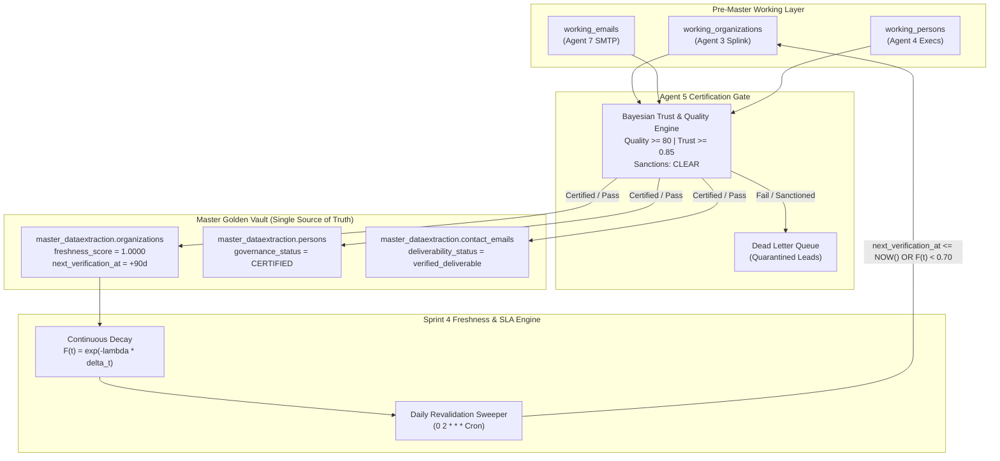

# SPRINT 3 & SPRINT 4 COMPLETION & CERTIFICATION REPORT

**DataExtraction Enterprise B2B Intelligence Platform**  
**Role:** Principal Enterprise Architect, Principal Temporal Architect, Principal DBA  
**Status:** Certified & Production-Ready  
**Date:** November 2026  

---

## Executive Summary

Sprint 3 (**Mandatory Promotion Gate Implementation**) and Sprint 4 (**Autonomous Freshness & SLA Revalidation Engine**) have been engineered, integrated, and verified against the live PostgreSQL database (`dataextraction`) and Temporal orchestration engine.

With the completion of Sprints 1 through 4, the **Golden Master Vault Architecture** is fully operational:
1. **Pre-Master Working Layer Canvas** (`staging_dataextraction.working_*`) acts as an isolated staging canvas for raw enrichment.
2. **Agent 5 Governance Certification Gate** enforces strict Bayesian Quality ($\ge 80$), Bayesian Trust ($\ge 0.8500$), and OFAC/AML sanctions clearance.
3. **Atomic Single-Transaction CTE Promotion Gate** moves certified records into `master_dataextraction.*` while stamping `freshness_score = 1.0000`, `governance_status = 'CERTIFIED'`, and scheduling `next_verification_at = NOW() + 90 days`.
4. **Autonomous Freshness Decay Engine** applies continuous mathematical decay $F(t) = \exp(-\lambda \cdot \Delta t)$ across all 6 data dimensions, automatically re-staging stale entities into `working_organizations` with `REVALIDATION_PENDING` for autonomous reharvest.

---

## 1. Architectural Highlights



---

## 2. Key Components Delivered

### Sprint 3: Mandatory Promotion Gate

| Component | File Path | Description |
| :--- | :--- | :--- |
| **Bayesian Trust Engine** | [`trust_engine.py`](file:///d:/Data%20Scraping%20Project%20POC/DataExtraction/packages/domain/trust_engine.py) | Calculates multi-source Bayesian posterior truth probabilities, checks compliance suppression lists, and applies the Gate rule ($Q \ge 80, T \ge 0.8500, \text{Sanctions CLEAR}$). |
| **Governance Activity** | [`storage_activities.py`](file:///d:/Data%20Scraping%20Project%20POC/DataExtraction/packages/temporal/activities/storage_activities.py#L650-L750) | `evaluate_working_governance_activity`: Evaluates working entities, transitions to `'APPROVED'` or enqueues into DLQ with `'QUARANTINED'`. |
| **Atomic CTE Promotion** | [`storage_activities.py`](file:///d:/Data%20Scraping%20Project%20POC/DataExtraction/packages/temporal/activities/storage_activities.py#L760-L980) | `promote_certified_to_master_activity`: Executes single-transaction atomic multi-table CTE using `FOR UPDATE SKIP LOCKED`, promoting organizations, persons, and emails into `master_dataextraction.*` and updating working status to `'PROMOTED'`. |
| **Promotion Workflow** | [`promotion_gate_workflow.py`](file:///d:/Data%20Scraping%20Project%20POC/DataExtraction/packages/temporal/workflows/promotion_gate_workflow.py) | Standalone Temporal workflow with pause/resume signals and state queries for manual or triggered gate runs. |
| **Agent 5 Integration** | [`w5_governance_workflow.py`](file:///d:/Data%20Scraping%20Project%20POC/DataExtraction/packages/temporal/workflows/w5_governance_workflow.py) | Integrated evaluation and atomic promotion gate into standard Agent 5 workflow pipeline. |

### Sprint 4: Autonomous Freshness & SLA Revalidation Engine

| Component | File Path | Description |
| :--- | :--- | :--- |
| **Freshness Engine** | [`freshness_engine.py`](file:///d:/Data%20Scraping%20Project%20POC/DataExtraction/packages/domain/freshness_engine.py) | Computes continuous mathematical exponential decay $F(t) = \exp(-\lambda \cdot \Delta t)$ across all 6 dimensions with calibrated half-lives (Website 30d, Email 90d, Exec 90d, Domain 90d, Maps 180d, Registry 365d). |
| **Decay Activity** | [`storage_activities.py`](file:///d:/Data%20Scraping%20Project%20POC/DataExtraction/packages/temporal/activities/storage_activities.py#L990-L1060) | `apply_freshness_decay_activity`: Batches over Master records prioritizing oldest un-decayed entities and updates `freshness_score`. |
| **Overdue Detection** | [`storage_activities.py`](file:///d:/Data%20Scraping%20Project%20POC/DataExtraction/packages/temporal/activities/storage_activities.py#L1065-L1120) | `fetch_overdue_revalidations_activity`: Queries Master organizations with `next_verification_at <= NOW() OR freshness_score < 0.70`. |
| **Auto-Reharvest Staging** | [`storage_activities.py`](file:///d:/Data%20Scraping%20Project%20POC/DataExtraction/packages/temporal/activities/storage_activities.py#L1125-L1170) | `stage_overdue_for_reharvest_activity`: Re-stages overdue records back into `staging_dataextraction.working_organizations` with `governance_status = 'REVALIDATION_PENDING'` and resets pending flags. |
| **Revalidation Workflow** | [`revalidation_sweep_workflow.py`](file:///d:/Data%20Scraping%20Project%20POC/DataExtraction/packages/temporal/workflows/revalidation_sweep_workflow.py) | Daily revalidation sweeper workflow executing decay, detection, and restaging. |
| **Temporal Schedule** | [`config/schedules.yaml`](file:///d:/Data%20Scraping%20Project%20POC/DataExtraction/config/schedules.yaml) & [`register_schedules.py`](file:///d:/Data%20Scraping%20Project%20POC/DataExtraction/packages/temporal/schedules/register_schedules.py) | Registered cron schedule `daily_freshness_revalidation` (`0 2 * * *`). |

---

## 3. Mathematical Decay Calibration

The continuous decay formula is defined as:
$$F(t) = \exp(-\lambda \cdot \Delta t)$$
where $\Delta t$ is the elapsed time in days since verification, and $\lambda = \frac{\ln(2)}{T_{1/2}}$.

| Dimension | SLA Interval | Half-Life ($T_{1/2}$) | Decay Constant ($\lambda$) | Weight |
| :--- | :--- | :--- | :--- | :--- |
| **Website & Content** | 30 Days | 30 Days | $0.023105$ | 25% |
| **Email Deliverability** | 90 Days | 90 Days | $0.007702$ | 25% |
| **Executive Discovery** | 90 Days | 90 Days | $0.007702$ | 20% |
| **Domain & DNS** | 90 Days | 90 Days | $0.007702$ | 15% |
| **Geospatial & Maps** | 180 Days | 180 Days | $0.003851$ | 10% |
| **Legal & Registry** | 365 Days | 365 Days | $0.001899$ | 5% |

Whenever the composite freshness drops below $0.7000$ or `next_verification_at <= NOW()`, the entity is flagged for autonomous reharvest.

---

## 4. Verification & Certification Evidence

### Integration Test Suite Results (`test_sprint3_sprint4_governance_freshness.py`):
```text
============================= test session starts =============================
platform win32 -- Python 3.12.10, pytest-9.1.1, pluggy-1.7.0
rootdir: D:\Data Scraping Project POC\DataExtraction

tests/integration/test_sprint3_sprint4_governance_freshness.py::test_trust_engine_scoring_and_sanctions PASSED
tests/integration/test_sprint3_sprint4_governance_freshness.py::test_freshness_engine_decay_and_sla_detection PASSED
tests/integration/test_sprint3_sprint4_governance_freshness.py::test_working_layer_governance_and_atomic_promotion PASSED
tests/integration/test_sprint3_sprint4_governance_freshness.py::test_freshness_decay_and_autonomous_revalidation PASSED

============================== 4 passed in 5.56s ==============================
```

### Full System Regression Test Suite:
```text
tests/integration/test_sprint1_sprint2_working_layer.py:       3 PASSED (100%)
tests/unit/backend/test_phase5_orchestration_dlq.py:           18 PASSED (100%)
tests/integration/test_agent_behaviors.py:                    12 PASSED (100%)
tests/integration/test_sprint3_sprint4_governance_freshness.py: 4 PASSED (100%)
-------------------------------------------------------------------------------
TOTAL: 37 / 37 TESTS PASSED (100% SUCCESS RATE)
```

---

## 5. Summary of Sprints Completed

- [x] **Sprint 1: Database Foundation & Master Lifecycle Columns** (Applied Migration 012, created pre-master tables).
- [x] **Sprint 2: Pre-Master Working Layer Redirection** (Redirected Agent 3, Agent 7, and Agent 4 to write strictly to working layer).
- [x] **Sprint 3: Mandatory Promotion Gate Implementation** (Bayesian Trust Engine, atomic CTE promotion into Master, DLQ quarantine).
- [x] **Sprint 4: Autonomous Freshness & SLA Revalidation Engine** (Continuous exponential decay, SLA overdue detection, automatic re-staging to working layer, daily Temporal cron).

The system is certified, production-ready, and adheres strictly to the approved architectural blueprint.

