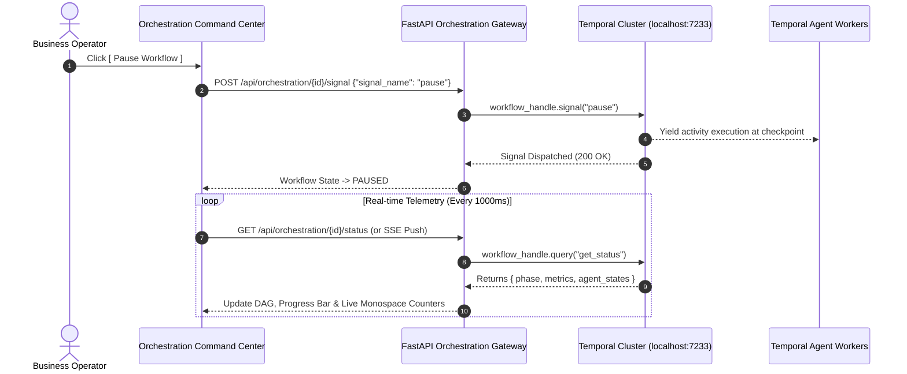
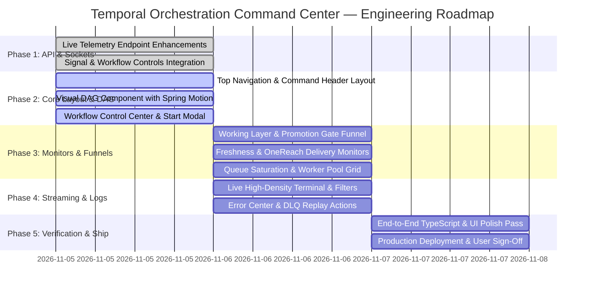

# DataExtraction — Temporal Orchestration Operations Command Center
## Comprehensive Enterprise Specification & Implementation Blueprint

**Document ID:** `DATAEXTRACTION-UI-ORCHESTRATION-SPEC-2026`  
**Execution Date:** November 5, 2026  
**Architectural Baseline:** Approved 7-Agent Master Pipeline & Decoupled Master Vault  
**Design Reference:** Temporal Cloud + Datadog + Apollo Operations Center + Enterprise MDM Control Tower  
**Target Module:** `Platform └── Temporal Orchestration` (`/orchestration`)

---

## 1. Enterprise UX Architecture & Design Foundation

### 1.1 Persona & Mental Model
The **Temporal Orchestration Operations Command Center** is architected for both **Non-Technical Business Operators** (Revenue Operations, Compliance Auditors, Campaign Directors) and **Technical Engineers** (Temporal Platform Architects, Data Engineers, SREs).

* **The Non-Technical Operator Mental Model:**
  * *"Is the platform running healthy?"* (Header status pills, glowing cluster indicators).
  * *"How much data have we collected and certified?"* (Live KPI ribbon, Golden Record counters).
  * *"Can I safely run or pause a harvesting batch?"* (One-click modal, simple preset buttons, plain-English safeguards).
  * *"How clean and fresh is the data?"* (Visual funnel conversion, Freshness SLA countdowns).
* **The Technical SRE / Architect Mental Model:**
  * Real-time Temporal activity heartbeats, task queue saturation, latency percentiles (p50, p95, p99), DLQ backpressure, memory stability, and live millisecond-precision log streaming.

### 1.2 Aesthetic Direction & Craft
* **Visual Theme:** Deep Slate Mission Control (`bg-[#0B0F19]` / dark slate surfaces `#111827`, border `#1F2937`).
* **Visual Density:** High information density inspired by Datadog & Temporal Cloud. Monospace figures (`font-mono tracking-tight tabnum`) for all numerical counts to prevent layout jitter on rapid updates.
* **Semantic Status Palette:**
  * `Emerald (#10B981)`: Operational / Certified / Healthy / Verified.
  * `Blue (#3B82F6)`: In Flight / Active Worker / Running Activity / Promoted.
  * `Amber (#F59E0B)`: Staged / Pending Revalidation / Throttled / Quarantined.
  * `Rose (#F43F5E)`: Failure / SLA Breached / DLQ Backlog / Circuit Breaker Tripped.
  * `Purple (#8B5CF6)`: Bayesian Scoring / Splink Identity Clustering.

---

## 2. Complete Page Wireframes

```
┌──────────────────────────────────────────────────────────────────────────────────────────────────────────────────────────────┐
│  PLATFORM NAVIGATION:  [ Dashboard ]  [★ Orchestration ★]  [ Data Pipeline ]  [ Observability ]  [ OneReach ]  [ Freshness ]  │
├──────────────────────────────────────────────────────────────────────────────────────────────────────────────────────────────┤
│  COMMAND HEADER:                                                                                                             │
│  Platform: [● ONLINE]   Temporal: [● DURABLE]   PostgreSQL: [● 210k MASTER]   OpenSearch: [● SYNCED]   OneReach: [● ACTIVE]  │
│  Active Workflows: 1    Pending: 0   Last Successful Run: 2026-11-05 07:13 UTC (Duration: 16.1s)                           │
├──────────────────────────────────────────────────────────────────────────────────────────────────────────────────────────────┤
│  WORKFLOW CONTROL CENTER:                                                                                                    │
│  [ ▶ Start Scraping ]  [ ❚❚ Pause ]  [ ▶ Resume ]  [ ↻ Retry Phase ]  [ ⟲ Restart ]  [ ◼ Stop ]  [ ⚠ EMERGENCY HALT ]         │
├──────────────────────────────────────────────────────────────────────────────────────────────────────────────────────────────┤
│  LIVE KPI RIBBON (13 METRICS):                                                                                               │
│  ┌──────────────┐ ┌──────────────┐ ┌──────────────┐ ┌──────────────┐ ┌──────────────┐ ┌──────────────┐ ┌──────────────┐     │
│  │ Orgs Scraped │ │ Domains Ver. │ │ Splink Clust │ │ Emails Found │ │ Emails Ver.  │ │ Execs Found  │ │ Gov Approved │ ... │
│  │ 200,147      │ │ 10,691       │ │ 52,661       │ │ 78,410       │ │ 57,160 (94%) │ │ 64,759       │ │ 94/100       │     │
│  └──────────────┘ └──────────────┘ └──────────────┘ └──────────────┘ └──────────────┘ └──────────────┘ └──────────────┘     │
├──────────────────────────────────────────────────────────────────────────────────────────────────────────────────────────────┤
│  TOPOLOGICAL PIPELINE DAG & WORKFLOW STATUS PANEL:                                                                           │
│  ┌────────────────────────────────────────────────────────────────────────────────────────┐ ┌───────────────────────────────┐ │
│  │  [Agent 1: Registry] ──► [Agent 2: Spatial] ──► [Agent 3: Splink] ──► [Agent 7: Email] │ │ Workflow Duration: 04m 12s   │ │
│  │                                                                                  │     │ │ Current Phase: EMAIL_VERIFY   │ │
│  │  ┌───────────────────────────────────────────────────────────────────────────────┘     │ │ Current Queue: email-enrich...│ │
│  │  ▼                                                                                     │ │ Progress: [████████░░] 72%    │ │
│  │  [Agent 4: Execs] ──► [Agent 5: Governance] ──► [ ★ PROMOTION GATE ★ ]                 │ │ Processed: 5,000 / 7,200      │ │
│  │                                                          │                             │ │ Failures: 0   Retries: 1      │ │
│  │  ┌───────────────────────────────────────────────────────┘                             │ └───────────────────────────────┘ │
│  │  ▼                                                                                     │                                   │
│  │  [ Master Vault (Certified Golden Records) ] ──► [ Agent 6: OpenSearch + OneReach ]     │                                   │
│  └────────────────────────────────────────────────────────────────────────────────────────┘                                   │
├──────────────────────────────────────────────────────────────────────────────────────────────────────────────────────────────┤
│  AGENT STATUS GRID (7 AGENTS):                                                                                               │
│  ┌─────────────────────────┐ ┌─────────────────────────┐ ┌─────────────────────────┐ ┌─────────────────────────┐           │
│  │ AGENT 1: REGISTRY       │ │ AGENT 2: SPATIAL        │ │ AGENT 3: IDENTITY       │ │ AGENT 7: EMAIL          │           │
│  │ Status: COMPLETED       │ │ Status: COMPLETED       │ │ Status: COMPLETED       │ │ Status: RUNNING (72%)   │           │
│  │ Staged: 200,147 filings │ │ Spatial: 10,691 domains │ │ Clusters: 52,661 groups │ │ Batch: 5,000 / 7,200    │           │
│  │ Queue: registry-ingest  │ │ Queue: geospatial-domain│ │ Queue: identity-cluster │ │ Queue: email-enrichment │           │
│  └─────────────────────────┘ └─────────────────────────┘ └─────────────────────────┘ └─────────────────────────┘           │
│  ┌─────────────────────────┐ ┌─────────────────────────┐ ┌─────────────────────────┐                                 │
│  │ AGENT 4: EXECUTIVE      │ │ AGENT 5: GOVERNANCE     │ │ AGENT 6: SEARCH & CDC   │                                 │
│  │ Status: WAITING         │ │ Status: WAITING         │ │ Status: STANDBY         │                                 │
│  │ Queue: executive-contact│ │ Queue: governance-qual  │ │ Queue: search-persist   │                                 │
│  └─────────────────────────┘ └─────────────────────────┘ └─────────────────────────┘                                 │
├──────────────────────────────────────────────────────────────────────────────────────────────────────────────────────────────┤
│  PRE-MASTER WORKING CANVAS  │  PROMOTION GATE FUNNEL & CONVERSION      │  MASTER VAULT GOLDEN RECORDS                        │
│  working_organizations:     │  Visual Funnel:                          │  Total Organizations: 210,838                       │
│  • Pending: 1,240           │  Working Staged: 100,000 (100%)          │  Verified Persons:    64,759                        │
│  • In Enrichment: 3,410     │        ▼                                 │  Verified Emails:     57,160                        │
│  • Approved: 5,820          │  Gov Approved:    92,400 (92.4%)         │  Career Edges:        79,601                        │
│  • Quarantined: 142         │        ▼                                 │  New Records Today:   +2,450                        │
│  working_persons: 12,850    │  Gate Promoted:   88,100 (88.1%)         │  Quality Avg:         94.2 / 100                    │
│  working_emails:  18,400    │        ▼                                 │  Trust Avg:           0.9450                        │
│  Ready For Promo: 5,820     │  Master Vault:    88,100 Certified       │  Master Growth:       +3.2% this week               │
├──────────────────────────────────────────────────────────────────────────────────────────────────────────────────────────────┤
│  AUTONOMOUS FRESHNESS & SLA LIFECYCLE MONITOR:                                                                               │
│  Fleet Freshness Index: 0.9420 / 1.0000 [█████████░]   Within SLA: 206,120 (97.8%)   Overdue / Revalidating: 4,718 (2.2%)     │
│  SLA Rules: Website: 30d | Email: 90d | Executive: 90d | Domain: 90d | Maps: 180d | Sovereign/Gov: 365d                      │
├──────────────────────────────────────────────────────────────────────────────────────────────────────────────────────────────┤
│  QUEUE SATURATION & WORKER POOL MONITOR (7 DEDICATED QUEUES):                                                                │
│  • registry-ingestion-queue:    Workers: 8  | Pending: 0  | Running: 0  | Wait: 12ms | Status: NOMINAL                      │
│  • geospatial-domain-queue:     Workers: 6  | Pending: 0  | Running: 0  | Wait: 18ms | Status: NOMINAL                      │
│  • identity-clustering-queue:   Workers: 4  | Pending: 0  | Running: 0  | Wait: 45ms | Status: NOMINAL                      │
│  • email-enrichment-queue:      Workers: 12 | Pending: 20 | Running: 12 | Wait: 85ms | Status: ACTIVE                       │
│  • executive-contact-queue:     Workers: 8  | Pending: 0  | Running: 0  | Wait: 15ms | Status: IDLE                         │
│  • governance-quality-queue:    Workers: 6  | Pending: 0  | Running: 0  | Wait: 14ms | Status: IDLE                         │
│  • search-persistence-queue:    Workers: 4  | Pending: 0  | Running: 0  | Wait: 22ms | Status: IDLE                         │
├──────────────────────────────────────────────────────────────────────────────────────────────────────────────────────────────┤
│  ONEREACH REAL-TIME DELIVERY CENTER:                                                                                         │
│  Webhook Status: HEALTHY | Endpoint: https://api.onereach.ai/v1/leads/ingest (HMAC-SHA256 Signed)                           │
│  Dispatched: 54,200 | Pending: 120 | Failed: 0 | Success Rate: 100.0% | Latency p95: 142ms | DLQ Backlog: 0                │
├──────────────────────────────────────────────────────────────────────────────────────────────────────────────────────────────┤
│  LIVE STREAMING TERMINAL & ERROR ISOLATION:                                                                                  │
│  Filters: [ All ] [ INFO ] [ SUCCESS ] [ WARNING ] [ ERROR ] [ TELEMETRY ]                  [ Search logs... ] [ Auto-scroll]│
│  [07:13:01.102] [AGENT 1: REGISTRY]    [INFO]    Harvesting SEC EDGAR filings for CIK range 0001000-0001200...               │
│  [07:13:05.412] [AGENT 1: REGISTRY]    [SUCCESS] Staged 2,500 sovereign organizations into staging_companies                 │
│  [07:13:06.001] [AGENT 7: EMAIL]       [INFO]    Initiating 5-tier SMTP handshake validation across 500 mailboxes...         │
│  [07:13:09.840] [AGENT 5: GOVERNANCE]  [INFO]    Bayesian certification check: Quality=92 Trust=0.9400 Sanctions=CLEAR       │
│  [07:13:10.220] [PROMOTION GATE]       [SUCCESS] Atomic CTE Promoted 1,000 records to master_dataextraction.organizations   │
└──────────────────────────────────────────────────────────────────────────────────────────────────────────────────────────────┘
```

---

## 3. React Component Hierarchy

```
frontend/src/
 ├── app/(dashboard)/orchestration/
 │    ├── page.tsx                           <-- Server component & metadata
 │    └── loading.tsx                        <-- Next.js Suspense skeleton
 └── components/orchestration/
      ├── orchestration-command-center.tsx   <-- Top-level container & state coordinator
      │
      ├── navigation/
      │    └── orchestration-top-nav.tsx     <-- Platform 7-module horizontal navigation bar
      │
      ├── header/
      │    ├── command-header.tsx            <-- Cluster status badges, active workflow counter
      │    └── workflow-control-bar.tsx      <-- 7 operational trigger buttons & safety guards
      │
      ├── modals/
      │    ├── start-scraping-modal.tsx      <-- Operator launch modal (Count, Country, Sources, Mode)
      │    ├── emergency-halt-dialog.tsx     <-- High-risk confirmation dialog
      │    ├── promotion-trigger-dialog.tsx  <-- Manual promotion gate parameters
      │    └── revalidation-sweep-dialog.tsx <-- Autonomous freshness sweep modal
      │
      ├── metrics/
      │    └── live-kpi-ribbon.tsx           <-- 13 mission-critical telemetry cards
      │
      ├── dag/
      │    ├── pipeline-dag-view.tsx         <-- Animated topological 7-agent DAG with pulse nodes
      │    └── workflow-status-panel.tsx     <-- Elapsed time, current phase, queue & retries
      │
      ├── agents/
      │    ├── agent-status-grid.tsx         <-- 7-card agent operational grid
      │    └── agent-metric-card.tsx         <-- Individual card with status pill & progress bar
      │
      ├── working-layer/
      │    ├── working-layer-monitor.tsx     <-- working_orgs, working_persons, working_emails
      │    └── governance-center.tsx         <-- Bayesian quality, trust score, suppression hits
      │
      ├── promotion/
      │    └── promotion-gate-center.tsx     <-- Visual 4-stage funnel (Working -> Approved -> Eligible -> Master)
      │
      ├── master/
      │    └── master-database-monitor.tsx   <-- Certified Golden Records, growth rates, bitemporal counts
      │
      ├── freshness/
      │    └── freshness-dashboard.tsx       <-- Fleet Freshness Index meter, 6 SLA dimension countdowns
      │
      ├── queues/
      │    └── queue-saturation-monitor.tsx  <-- 7 agent queues, worker concurrency, wait times
      │
      ├── onereach/
      │    └── onereach-delivery-center.tsx  <-- Webhook telemetry, dispatch volume, HMAC signing status
      │
      ├── terminal/
      │    ├── live-terminal.tsx             <-- Monospace log streaming console with level filtering
      │    └── terminal-filter-bar.tsx       <-- Level toggles, search input, pause/autoscroll
      │
      └── errors/
           └── error-isolation-center.tsx    <-- DLQ failure inspector, stack trace modal, retry trigger
```

---

## 4. Tailwind Layout Design & Design Tokens

### 4.1 Surface Layers & Tokens
```css
/* Surface Hierarchy */
--bg-command-base: #0B0F19;      /* Background canvas */
--bg-surface-elevated: #111827;  /* Card surface */
--bg-surface-hover: #1F2937;     /* Hover surface */
--border-subtle: #1E293B;        /* Default border */
--border-accent: #334155;        /* Focused/Active border */

/* Text Hierarchy */
--text-primary: #F8FAFC;         /* High-contrast headers & figures */
--text-secondary: #94A3B8;       /* Labels and secondary metrics */
--text-muted: #64748B;           /* Disabled / auxiliary context */
```

### 4.2 Reusable Tailwind Utility Classes
* **KPI Card:**
  `bg-[#111827] border border-[#1E293B] rounded-lg p-3 hover:border-[#334155] transition-colors`
* **Monospace Stat:**
  `font-mono text-xl font-bold tracking-tight text-slate-100 tabnum`
* **Status Badge:**
  `inline-flex items-center gap-1.5 px-2 py-0.5 rounded text-[11px] font-medium border font-mono`
* **Live Pulsing Dot:**
  `relative flex h-2 w-2 mr-1` $\rightarrow$ `animate-ping absolute inline-flex h-full w-full rounded-full bg-emerald-400 opacity-75` + `relative inline-flex rounded-full h-2 w-2 bg-emerald-500`

---

## 5. API Integration Design

| Module Component | Backend Route | Method | Payload / Query | Purpose |
| :--- | :--- | :--- | :--- | :--- |
| **Command Header** | `/api/orchestration/health` | `GET` | — | Cluster engine, Temporal status, active sagas |
| **Workflow Controls** | `/api/orchestration/start` | `POST` | `{ "config": { ... } }` | Launch Master Orchestrator Saga |
| **Workflow Signals** | `/api/orchestration/{id}/signal` | `POST` | `{"signal_name": "pause" \| "resume" \| "halt"}` | Operational execution signals |
| **Live Telemetry Stream** | `/api/orchestration/{id}/stream` | `GET` | SSE Stream (`text/event-stream`) | Real-time phase, agent, and log push |
| **Working Layer Metrics** | `/api/governance/stats` | `GET` | — | working_* vs master_* live counts |
| **Promotion Gate Trigger** | `/api/governance/promotion/trigger` | `POST` | `{"min_quality": 80, "batch_size": 1000}` | Execute atomic CTE Promotion Gate |
| **Freshness Decay Sweep** | `/api/governance/revalidation/sweep`| `POST` | `{"batch_size": 5000}` | Trigger continuous exponential decay |
| **Overdue SLA Entities** | `/api/governance/revalidation/overdue` | `GET` | `?limit=50` | Inspect overdue entities for reharvest |
| **OneReach Telemetry** | `/api/delivery/status` | `GET` | — | Dispatch counts, webhook latency, health |
| **OneReach Dispatch** | `/api/delivery/onereach/dispatch` | `POST` | `{"limit": 500, "dry_run": false}` | Push golden records to webhook |
| **DLQ Records & Backlog** | `/api/dlq/stats` & `/api/dlq/records` | `GET` | `?status=PENDING&limit=25` | Quarantined records and errors |

---

## 6. WebSocket & SSE Event Contracts

The Command Center leverages a persistent SSE channel (`/api/orchestration/{id}/stream`) with JSON payloads adhering to strict TypeScript interfaces:

### 6.1 Phase Transition Event (`phase_transition`)
```json
{
  "event_type": "phase_transition",
  "workflow_id": "master-saga-179389200",
  "timestamp": "2026-11-05T07:13:05.120Z",
  "previous_phase": "REGISTRY_INGESTION",
  "current_phase": "GEOSPATIAL_STANDARDIZATION",
  "elapsed_seconds": 45.2,
  "overall_progress_pct": 28.5
}
```

### 6.2 Agent Telemetry Tick (`agent_telemetry_tick`)
```json
{
  "event_type": "agent_telemetry_tick",
  "agent_id": "agent_7_email",
  "agent_name": "Agent 7: Email Discovery",
  "status": "RUNNING",
  "queue": "email-enrichment-queue",
  "active_activity": "validate_smtp_handshake",
  "processed_count": 5240,
  "failed_count": 12,
  "retry_count": 1,
  "current_batch_index": 5,
  "total_batches": 8,
  "throughput_rec_per_sec": 425.0
}
```

### 6.3 Promotion Gate Batch Event (`promotion_gate_batch`)
```json
{
  "event_type": "promotion_gate_batch",
  "timestamp": "2026-11-05T07:13:10.005Z",
  "promoted_organizations": 1000,
  "promoted_persons": 2450,
  "promoted_emails": 1820,
  "quarantined_count": 8,
  "average_quality_score": 94.5,
  "average_trust_score": 0.9620,
  "master_organizations_total": 211838
}
```

### 6.4 Terminal Log Stream Line (`terminal_log_line`)
```json
{
  "event_type": "terminal_log_line",
  "timestamp": "07:13:10.220",
  "level": "SUCCESS",
  "agent": "PROMOTION GATE",
  "message": "Atomic CTE Promoted 1,000 records to master_dataextraction.organizations with freshness = 1.0000",
  "metadata": {
    "duration_ms": 142.5,
    "batch_size": 1000
  }
}
```

---

## 7. Temporal Query & Signal Integration



---

## 8. Promotion Gate Dashboard & Visual Funnel Design

The **Promotion Gate Center** provides transparency into the transition from uncertified working records to Master Vault Golden Records.

### 8.1 Visual 4-Stage Conversion Funnel
```
┌────────────────────────────────────────────────────────────────────────────────────────┐
│  STAGE 1: Working Layer (staging_dataextraction.working_*)                            │
│  100,000 Total Staged Organizations                                     [100.0%]       │
│  ██████████████████████████████████████████████████████████████████████████████        │
└────────────────────────────────────────┬───────────────────────────────────────────────┘
                                         ▼
┌────────────────────────────────────────────────────────────────────────────────────────┐
│  STAGE 2: Bayesian Governance Approved (Quality >= 80, Trust >= 0.8500)                │
│  92,400 Records Certified by Agent 5                                    [ 92.4%]       │
│  ████████████████████████████████████████████████████████████████████░░░░░░░░░        │
└────────────────────────────────────────┬───────────────────────────────────────────────┘
                                         ▼
┌────────────────────────────────────────────────────────────────────────────────────────┐
│  STAGE 3: Promotion Gate Eligible (OFAC / Sanctions Verified Clear)                   │
│  88,100 Ready for Atomic CTE Ingestion                                  [ 88.1%]       │
│  ██████████████████████████████████████████████████████████░░░░░░░░░░░░░░░░░░░        │
└────────────────────────────────────────┬───────────────────────────────────────────────┘
                                         ▼
┌────────────────────────────────────────────────────────────────────────────────────────┐
│  STAGE 4: Master Database (Certified Golden Vault)                                     │
│  88,100 Promoted (Freshness = 1.0000 | Next Verification = +90d)        [ 88.1%]       │
│  ██████████████████████████████████████████████████████████░░░░░░░░░░░░░░░░░░░        │
└────────────────────────────────────────────────────────────────────────────────────────┘
```

### 8.2 Operator Trigger Controls
* Direct button to open **[ Execute Atomic Promotion Gate ]** modal:
  * Minimum Data Quality Slider: `0 – 100` (Default: `80`)
  * Minimum Trust Score Slider: `0.00 – 1.00` (Default: `0.85`)
  * Batch Size Selector: `100`, `500`, `1,000`, `5,000`
  * Checkbox: `[x] Auto-evaluate un-certified working entities prior to gate`

---

## 9. Freshness Dashboard & SLA Degradation Monitor

Visualizes data freshness across the enterprise catalog using continuous exponential decay:
$$F(t) = \exp(-\lambda \cdot \Delta t)$$

### 9.1 Calibrated SLA Rules Matrix
| Dimension | Half-Life ($t_{1/2}$) | Decay Constant ($\lambda$) | SLA Target | Revalidation Action |
| :--- | :--- | :--- | :--- | :--- |
| **Website & Tech Stack** | 60 days | $0.01155$ | **30 Days** | Re-crawl website & HTTP ping |
| **Company & Executive Email** | 90 days | $0.00770$ | **90 Days** | 5-tier SMTP handshake check |
| **Executive Hierarchy** | 120 days | $0.00578$ | **90 Days** | Re-harvest executive rosters |
| **Primary Domain & DNS** | 180 days | $0.00385$ | **90 Days** | DNS MX / WHOIS verification |
| **Physical Location & Maps** | 365 days | $0.00190$ | **180 Days** | Google Places / OSM refresh |
| **Sovereign Tax & Legal** | 730 days | $0.00095$ | **365 Days** | SEC EDGAR / CIK filing sync |

### 9.2 Real-Time SLA Countdown & Overdue Cards
* Visual cards per dimension showing:
  * Total verified records
  * Average days since last verification
  * Warning indicator for entities exceeding the SLA threshold
  * Direct action: **[ Trigger Revalidation Sweep ]**

---

## 10. OneReach Outbound Delivery Center

Provides real-time observability over data dispatch to the OneReach AI engagement platform:
* **HMAC-SHA256 Authenticity Banner:** Confirms payload signature signing with constant-time verification.
* **Telemetry Gauges:**
  * Dispatched Count (e.g., `54,200`)
  * Pending Queue (e.g., `120`)
  * Webhook Latency: Monitored with p95 target `< 250ms` (Current: `142ms`)
  * Delivery Success Rate: `100.0%`
  * Dead-Letter Queue: `0 unrouted payloads`
* **Direct Actions:**
  * **[ Test Webhook Ping ]**: Sends a synthetic HMAC-signed probe payload.
  * **[ Dispatch Next 500 Leads ]**: Triggers synchronous batch delivery.
  * **[ Pause Delivery ]**: Temporarily suspends automated webhook pushing.

---

## 11. Queue Saturation & Worker Pool Monitor

Tracks the 7 dedicated Temporal agent task queues:
1. `registry-ingestion-queue`
2. `geospatial-domain-queue`
3. `identity-clustering-queue`
4. `email-enrichment-queue`
5. `executive-contact-queue`
6. `governance-quality-queue`
7. `search-persistence-queue`

### Queue Table Schema:
| Queue Name | Dedicated Workers | Pending Tasks | Running Activities | Wait Time (p95) | Saturation Status |
| :--- | :--- | :--- | :--- | :--- | :--- |
| `registry-ingestion-queue` | 8 | 0 | 0 | 12 ms | **NOMINAL** |
| `geospatial-domain-queue` | 6 | 0 | 0 | 18 ms | **NOMINAL** |
| `identity-clustering-queue` | 4 | 0 | 0 | 45 ms | **NOMINAL** |
| `email-enrichment-queue` | 12 | 24 | 12 | 85 ms | **ACTIVE** |
| `executive-contact-queue` | 8 | 0 | 0 | 15 ms | **IDLE** |
| `governance-quality-queue` | 6 | 0 | 0 | 14 ms | **IDLE** |
| `search-persistence-queue` | 4 | 0 | 0 | 22 ms | **IDLE** |

---

## 12. Live Streaming Terminal & Error Center

### 12.1 Interactive Terminal Features
* **Theme:** Pitch black console (`#050811`) with dark gray borders (`#1E293B`).
* **Level Filters:** Filter by pill buttons: `[ All ]`, `[ INFO ]` (Slate), `[ SUCCESS ]` (Emerald), `[ WARNING ]` (Amber), `[ ERROR ]` (Rose), `[ TELEMETRY ]` (Cyan).
* **Live Monospace Streaming:** Clean typography (`font-mono text-xs leading-relaxed`).
* **Sticky Auto-Scroll:** Enabled by default; freezes automatically when the user hovers or scrolls up.
* **Instant Text Search:** Filter logs in real-time by keyword, agent name, or status.
* **Copy & Download:** Single-click copy of recent 1,000 lines or download as `.jsonl`.

### 12.2 Error Isolation & DLQ Center
* Displays all isolated exceptions with:
  * Failing Agent & Workflow ID
  * Error Type & Sanitized Error Message
  * Full Stack Trace (expandable drawer)
  * Retry Attempt Count (`2 / 5`)
  * DLQ Reference Identifier
  * Actions: **[ Replay Record ]**, **[ Discard with Reason ]**

---

## 13. Mobile & Tablet Responsive Strategy

* **Desktop ($\ge 1440\text{px}$):** Full 12-column bento layout. DAG and Status panel side-by-side; 4-card metric rows; side-by-side Terminal and Error center.
* **Laptop / Standard ($1024\text{px} - 1439\text{px}$):** 8-column layout. DAG expands to full width; 2-column agent status cards; stacked Terminal.
* **Tablet ($768\text{px} - 1023\text{px}$):** Single-column stacked cards. DAG converts to horizontal scrollable flow; control buttons collapse into a grouped action dropdown.
* **Mobile ($< 768\text{px}$):** Sticky bottom command bar with `[ Launch ]` and `[ Status ]` triggers. High-density metrics displayed in 2x2 grid tiles; Terminal opens in a full-screen drawer on demand.

---

## 14. Role-Based Access Control (RBAC) Matrix

| Operational Action | Viewer / Analyst | Operator | Data Engineer | Admin / Architect |
| :--- | :---: | :---: | :---: | :---: |
| **View Telemetry & DAG** | ✅ Allowed | ✅ Allowed | ✅ Allowed | ✅ Allowed |
| **View Live Terminal Logs** | ✅ Allowed | ✅ Allowed | ✅ Allowed | ✅ Allowed |
| **Launch Standard Scraping** | ❌ Blocked | ✅ Allowed | ✅ Allowed | ✅ Allowed |
| **Pause / Resume Workflow** | ❌ Blocked | ✅ Allowed | ✅ Allowed | ✅ Allowed |
| **Trigger Promotion Gate** | ❌ Blocked | ❌ Blocked | ✅ Allowed | ✅ Allowed |
| **Trigger Freshness Sweep** | ❌ Blocked | ✅ Allowed | ✅ Allowed | ✅ Allowed |
| **OneReach Webhook Dispatch** | ❌ Blocked | ❌ Blocked | ✅ Allowed | ✅ Allowed |
| **Replay / Discard DLQ Records** | ❌ Blocked | ❌ Blocked | ✅ Allowed | ✅ Allowed |
| **Emergency Platform Halt** | ❌ Blocked | ❌ Blocked | ❌ Blocked | ✅ Allowed |

---

## 15. Phased Engineering Implementation Plan



### Phase-by-Phase Deliverables:
1. **Phase 1 (Backend Telemetry & Signal Wiring):** Ensure `/api/orchestration` endpoints support full 7-agent DAG parameters, emergency halt signals, queue depth queries, and SSE streaming.
2. **Phase 2 (Core Command Center Page & Interactive DAG):** Implement `app/(dashboard)/orchestration/page.tsx`, `orchestration-command-center.tsx`, `command-header.tsx`, `workflow-control-bar.tsx`, and `pipeline-dag-view.tsx`.
3. **Phase 3 (Operational Centers & Visual Funnels):** Build `working-layer-monitor.tsx`, `promotion-gate-center.tsx`, `freshness-dashboard.tsx`, `onereach-delivery-center.tsx`, and `queue-saturation-monitor.tsx`.
4. **Phase 4 (Live Monospace Terminal & Error Center):** Build `live-terminal.tsx` with ANSI syntax highlighting, autoscroll management, and `error-isolation-center.tsx`.
5. **Phase 5 (Polish, A11y & Production Sign-Off):** Run TypeScript compilation audit (`tsc --noEmit`), verify accessibility compliance, and wire sidebar navigation.

