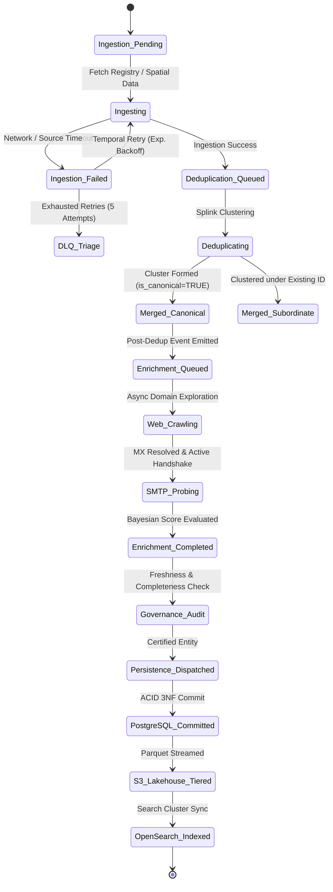

# DataExtraction Technical Architecture: High-Level Technical Workflow
**Enterprise Technical Specification & System Workflow Guide**  
**Audience:** VP of Engineering, Lead Architects, Technical Leads, & Engineering Teams  
**System:** DataExtraction Enterprise B2B Lead Intelligence & Entity Resolution Engine  
**Version:** Production v3.2.0  
**Date:** October 2026  

---

## 1. Architectural Philosophy & Orchestration Principles

The **DataExtraction** platform is an enterprise-grade, distributed, event-driven data intelligence engine designed to extract, resolve, enrich, and index statutory and commercial entity data at petabyte scale.

```
┌─────────────────────────────────────────────────────────────────────────────────────────────────┐
│                                 CORE ARCHITECTURAL PRINCIPLES                                   │
├───────────────────────┬─────────────────────────┬────────────────────────┬──────────────────────┤
│ 1. Zero Vendor Tax    │ 2. Post-Dedup Isolation │ 3. Distributed Sagas   │ 4. Triple Storage    │
├───────────────────────┼─────────────────────────┼────────────────────────┼──────────────────────┤
│ No third-party API    │ Enrichment executes     │ Temporal.io guarantees │ PostgreSQL (3NF/OLTP)│
│ fees (Apollo/ZoomInfo)│ strictly on canonical   │ exactly-once semantics,│ MinIO S3 (Lakehouse) │
│ or external black-box │ entities after Splink   │ stateful retries, and  │ OpenSearch (Search   │
│ enrichment tools.     │ deduplication.          │ automatic compensation.│ & Analytics Cluster) │
└───────────────────────┴─────────────────────────┴────────────────────────┴──────────────────────┘
```

### Core Design Rules
1. **Statutory Truth First**: Official government registries (SEC EDGAR, CMS NPI, SAM.gov, FDIC) form the foundational backbone of record truth.
2. **Mathematical Deduplication (Fellegi-Sunter)**: High-dimensional probabilistic record linkage via Splink and connected components graph clustering eliminates duplicate company profiles before expensive enrichment runs.
3. **Canonical Enrichment Boundary**: Email enrichment is never executed on unmerged raw fragments. Only canonical entities (`is_canonical = TRUE`) trigger domain exploration and active SMTP handshakes.
4. **Zero Intrusive Spam**: Active validation utilizes RFC-5321 non-intrusive `RCPT TO` handshakes terminated via `RSET`/`QUIT` without ever delivering message bodies.

---

## 2. End-to-End Technical Workflow Pipeline

The end-to-end data processing lifecycle is orchestrated across seven sequential, resilient stages executed by specialized autonomous agents:

```
                                  DATA PROCESSING HIGH-LEVEL PIPELINE
                                  
  ┌─────────────────────────────────┐               ┌─────────────────────────────────┐
  │   STAGE 1: STATUTORY INGEST     │               │   STAGE 2: GEOSPATIAL HARVEST   │
  │ • SEC EDGAR (CIK, Form 10-K)    │               │ • Google Maps Places Footprint  │
  │ • CMS NPI Healthcare Registry   │               │ • OpenStreetMap Overpass API    │
  │ • SAM.gov Federal Contractors   │               │ • Quadtree Bounding Box Tiling  │
  └────────────────┬────────────────┘               └────────────────┬────────────────┘
                   │                                                 │
                   └───────────────────────┬─────────────────────────┘
                                           │
                                           ▼
  ┌───────────────────────────────────────────────────────────────────────────────────┐
  │                   STAGE 3: PROBABILISTIC DEDUPLICATION & MERGING                  │
  │ • Splink EM (Expectation-Maximization) probabilistic record linkage               │
  │ • Normalized Jaro-Winkler, Levenshtein, & Soundex phonetic distance metrics       │
  │ • Connected Components Graph Clustering -> Canonical Record Creation              │
  └────────────────────────────────────────┬──────────────────────────────────────────┘
                                           │
                                           │ [Triggered on is_canonical = TRUE]
                                           ▼
  ┌───────────────────────────────────────────────────────────────────────────────────┐
  │               STAGE 4: POST-DEDUP EMAIL DISCOVERY & ACTIVE SMTP PROBE             │
  │ • Async multi-page web crawler (/contact, /about, /team, /leadership)             │
  │ • Regex extraction, Cloudflare email XOR decoder, HTML entity parser              │
  │ • Asynchronous DNS MX lookups with in-memory TTL caching                          │
  │ • Non-intrusive SMTP handshake (HELO -> MAIL FROM -> RCPT TO -> RSET)            │
  │ • Randomized honeypot catch-all domain detection                                  │
  │ • Multi-factor Bayesian deliverability score (0.00 – 1.00)                        │
  └────────────────────────────────────────┬──────────────────────────────────────────┘
                                           │
                                           ▼
  ┌───────────────────────────────────────────────────────────────────────────────────┐
  │                    STAGE 5: EXECUTIVE LEADERSHIP GRAPH MAPPING                    │
  │ • Officer, Director, and C-Suite extraction from 10-K/Proxy filings & web pages   │
  │ • Professional role classification and corporate hierarchy linking                │
  └────────────────────────────────────────┬──────────────────────────────────────────┘
                                           │
                                           ▼
  ┌───────────────────────────────────────────────────────────────────────────────────┐
  │                STAGE 6: BAYESIAN DATA GOVERNANCE & QUALITY AUDIT                  │
  │ • Temporal freshness decay & half-life calculation                                │
  │ • Multi-dimensional quality scoring (Completeness, Provenance, Validity)          │
  │ • Outlier & anomaly detection prior to operational publishing                     │
  └────────────────────────────────────────┬──────────────────────────────────────────┘
                                           │
                                           ▼
  ┌───────────────────────────────────────────────────────────────────────────────────┐
  │             STAGE 7: TRIPLE-STORE PERSISTENCE & ANALYTICS CDC DISPATCH            │
  │ • PostgreSQL 3NF: Operational transactional graph & audit logs                    │
  │ • MinIO S3 Lakehouse: Compressed columnar Parquet partitions for big data analytics│
  │ • OpenSearch Cluster: Sub-50ms full-text and faceted search vector indexing       │
  └───────────────────────────────────────────────────────────────────────────────────┘
```

---

## 3. Deep-Dive: Stage-by-Stage Technical Execution

### Stage 1: Official Statutory & Registry Ingestion (Agent 1)
- **Task Queue**: `federal-ingestion`
- **Data Sources**:
  - **SEC EDGAR**: Daily index feeds, Company Submissions API, Form 10-K, 10-Q, 8-K filings.
  - **CMS NPI (National Provider Identifier)**: Monthly/weekly full registry exports (NPPES).
  - **SAM.gov**: System for Award Management active federal entity registrations.
  - **FDIC / State Registries**: BankFind and corporate registrar APIs.
- **Normalization Engine**:
  - Cleans legal names, strips corporate suffixes (`LLC`, `Inc.`, `Corp`, `LLP`, `GmbH`), standardizes federal EIN/TIN numbers, standardizes US states and postal codes.
  - Generates immutable source record identifiers for provenance tracking.

### Stage 2: Geospatial & Local Footprint Extraction (Agent 2)
- **Task Queue**: `gmaps-extraction`, `osm-extraction`
- **Algorithms**:
  - **Quadtree Spatial Tiling**: Recursively decomposes target geographic bounding boxes into sub-tiles when entity density exceeds per-request API limits.
  - **Overpass QL Queries**: Extracts business metadata, amenities, websites, opening hours, and geographic coordinates from OpenStreetMap.
  - **Place Detail Reconciliation**: Reconciles physical storefront addresses with registered corporate entity addresses.

### Stage 3: Probabilistic Entity Resolution & Deduplication (Agent 3)
- **Task Queue**: `identity-clustering-queue`
- **Engine**: **Splink (DuckDB / Spark backend)** implementing the **Fellegi-Sunter** method of record linkage.
- **Comparison Rules**:
  - Exact match on Tax ID / CIK (Weight: $\gamma_1 = 1.0$)
  - Jaro-Winkler match on cleaned company name with custom threshold ($\ge 0.92$)
  - Levenshtein distance on street addresses and postal code matching
  - Domain identity comparison (stripping subdomains and protocol schemes)
- **Graph Clustering**:
  - Constructs adjacency graphs from pairwise match probabilities exceeding 0.85.
  - Solves connected components to group disparate source records into a single **Canonical Entity Cluster**.
  - Merges metadata into a primary Golden Record marked with `is_canonical = TRUE`.

### Stage 4: Post-Deduplication Email Discovery & Active SMTP Validation (Agent 7)
- **Task Queue**: `email-enrichment-queue`
- **Trigger**: Emitted exclusively after Stage 3 deduplication succeeds on a canonical entity.
- **Sub-Pipeline Components**:
  1. **Domain Extraction**: Resolves official corporate web domain from canonical record.
  2. **Asynchronous Multi-Page Crawler (`AsyncEmailWebCrawler`)**:
     - Respects `robots.txt`, implements per-domain concurrency throttling.
     - Automatically crawls primary paths: `/`, `/contact`, `/about`, `/team`, `/leadership`, `/support`.
     - Fast regex email parser matching RFC-5322 specs.
     - **Cloudflare Protected Email Decoder**: Detects `data-cfemail` hex attributes and decodes via bitwise XOR.
     - **HTML Entity Sanitizer**: Resolves obfuscations such as `&#64;`, `[at]`, `(at)`.
  3. **DNS MX Resolver**:
     - Asynchronously queries high-priority mail exchange (MX) records.
     - In-memory LRU cache prevents repeated DNS pressure on popular mail providers (Google Workspace, Microsoft 365).
  4. **Active Non-Intrusive SMTP Handshake (`SMTPValidatorService`)**:
     - Establishes raw socket connection to primary MX server on port 25.
     - Issues conversational sequence:
       ```
       C: HELO mail.dataextraction.internal
       S: 250 mail.recipient-domain.com
       C: MAIL FROM:<probe@dataextraction.internal>
       S: 250 Sender OK
       C: RCPT TO:<discovered.lead@domain.com>
       S: 250 Recipient OK / 550 User Not Found
       C: RSET
       C: QUIT
       ```
  5. **Catch-All Honeypot Detection**:
     - Generates a randomized non-existent mailbox (`verify-random-uuid83920@domain.com`).
     - If the mail exchanger accepts `RCPT TO` for this randomized address, the domain is flagged as `is_catch_all = TRUE`, adjusting confidence thresholds.
  6. **Bayesian Score Synthesis**:
     - Synthesizes syntax validity, MX presence, SMTP code response, catch-all status, and page provenance into a unified score $\in [0.0, 1.0]$.
     - Emails with score $\ge 0.80$ receive `DELIVERABLE` certification.

### Stage 5: Executive Leadership & Org Graph Mapping (Agent 4)
- **Task Queue**: `executive-contact-queue`
- **Logic**:
  - Ingests SEC Form 10-K Item 10 (Executive Officers) and Form DEF 14A (Proxy Statements).
  - Matches executive names to corporate domains.
  - Generates verified executive contact records linked via foreign keys to the canonical enterprise ID.

### Stage 6: Bayesian Data Governance & Quality Audit (Agent 5)
- **Task Queue**: `governance-quality-queue`
- **Quality Dimensions**:
  - **Completeness**: Evaluates presence of mandatory business fields (EIN, address, phone, verified email, NAICS/SIC code).
  - **Freshness Decay**: Applies exponential time-decay function:
    $$S_{fresh}(t) = S_0 \cdot e^{-\lambda t}$$
    Flags entities requiring automated re-ingestion after 90 days.
  - **Anomaly Detection**: Flags suspicious patterns (e.g., disposable domains, IP blacklists).

### Stage 7: Dual-Store Persistence & Search Indexing (Agent 6)
- **Task Queue**: `search-persistence-queue`
- **Storage Tiering**:
  1. **PostgreSQL 3NF**: Write-ahead transaction log, referential integrity, relational join support, and JSONB audit trails.
  2. **MinIO S3 Object Lakehouse**: Periodic bulk streaming of canonical entities into Zstandard-compressed Parquet files organized by date and industry partitions.
  3. **OpenSearch 2.x Cluster**: Near real-time Change Data Capture (CDC) dispatch indexing canonical documents for faceted search (<50ms response latency).

---

## 4. Distributed Fault Tolerance & Saga State Machine

DataExtraction employs the **Saga Pattern** orchestrated by **Temporal.io**. Each stage represents a discrete, idempotent Activity. If an unrecoverable failure occurs, compensatory actions rollback intermediate state or route the record to the Dead-Letter Queue (DLQ).



### Circuit Breakers & Backpressure Control
- **Per-Domain Rate Limiter**: Maximum 2 concurrent connections per target domain during web crawling.
- **SMTP Throttling**: Leaky bucket rate limiter strictly bounds outbound SMTP probes to a maximum of 5 requests per second per target mail exchange server to prevent blacklisting.
- **Circuit Breaker**: If 3 consecutive SMTP connections to a specific MX provider timeout, the circuit breaker opens for 120 seconds, bypassing SMTP checks and falling back to DNS MX validation.

---

## 5. Dead-Letter Queue (DLQ) & Self-Healing Resilience

When unexpected network drops, schema changes in statutory sources, or corrupt payload formats occur, records are quarantined in the **Dead-Letter Queue (DLQ)** without halting the pipeline:

```
┌─────────────────────────────────────────────────────────────────────────────┐
│                          DLQ RESILIENCE SUBSYSTEM                           │
├─────────────────────────────────────────────────────────────────────────────┤
│ 1. Quarantine: Failed job state & error stack trace stored in DLQ table.   │
│ 2. Classification: Errors categorized into RETRIABLE, FATAL, or TRANSIENT.  │
│ 3. Automated Re-Drive: Exponential backoff scheduler retries transient bugs.│
│ 4. REST Management API: Engineers inspect, edit, and re-drive via API:      │
│    POST /api/v1/dlq/redrive/{job_id}                                        │
│    DELETE /api/v1/dlq/purge/{job_id}                                        │
└─────────────────────────────────────────────────────────────────────────────┘
```

---

## 6. API Gateway & Scheduler Architecture

### FastAPI Gateway Architecture
The platform exposes a secured, asynchronous RESTful API:
- `POST /api/v1/enrichment/jobs`: Trigger on-demand email enrichment for a canonical company.
- `GET /api/v1/enrichment/jobs/{job_id}`: Poll asynchronous enrichment progress and Bayesian score.
- `GET /api/v1/companies/search`: Multi-faceted query interface against OpenSearch cluster.
- `GET /api/v1/health`: Cluster health check (PostgreSQL, MinIO, OpenSearch, Temporal).

### Enterprise Scheduling (Without AWS Lock-In)
- Ingestion schedules are managed natively via **Temporal Cron Schedules** and **APScheduler**.
- Pre-configured schedules in `config/schedules.yaml`:
  - `sec-edgar-daily`: Runs Monday through Friday at 01:00 UTC.
  - `cms-npi-weekly`: Runs every Sunday at 03:00 UTC.
  - `data-freshness-sweep`: Runs daily at 00:00 UTC to decrement entity freshness scores.
- Zero dependency on AWS EventBridge, AWS CloudWatch, or proprietary cloud schedulers—enabling 100% on-premise or cloud-agnostic execution.

