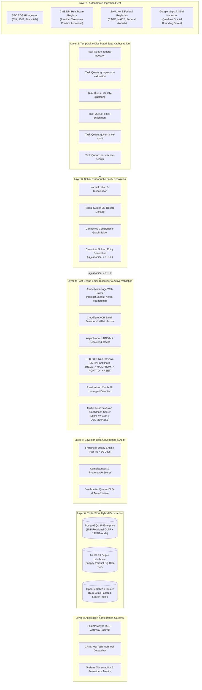
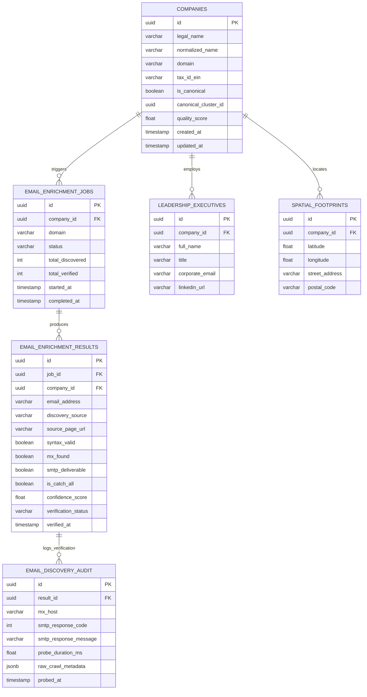

# DataExtraction Enterprise Platform: Visual Architecture & Antigravity Image Prompt
**System Architecture Blueprint & Generative Visual Specifications**  
**Audience:** Executive Committee, Engineering Leadership, Presentation Designers  
**System:** DataExtraction Enterprise B2B Lead Intelligence Engine  
**Release:** Production v3.2.0  
**Date:** October 2026  

---

## 1. High-Level Enterprise Architecture Diagram



---

## 2. Relational Database Entity-Relationship (ER) Schema



---

## 3. High-Fidelity Antigravity Image Generation Prompt

Below is the exact, uncompromised prompt engineered for **Google Antigravity / Midjourney v6 / Flux.1 / Imagen 3** to produce a cinematic, executive-ready 3D isometric architectural illustration for presenting to the CEO, CFO, and Technical Board.

```text
A hyper-detailed, photorealistic 3D isometric architectural visualization of a high-throughput enterprise AI intelligence and data extraction platform called 'DataExtraction Enterprise'. 

The composition is arranged as an elegant multi-tiered crystalline floating glass tech island against a sleek deep navy-blue and dark graphite tech background (#0A0E17). Crisp studio volumetric edge lighting in electric cyan (#00F2FE), luminous violet (#8A2BE2), and laser amber-gold accents (#FFB800).

TIER 1 (Bottom Left - Ingestion Harvester):
Luminescent holographic ingestion nodes representing SEC EDGAR filings, federal databases, and global maps. Translucent data streams flow through high-speed fiber-optic pathways into a central hub.

TIER 2 (Center - Probabilistic Identity Engine):
A glowing spherical neural-clustering engine representing 'Splink AI Entity Resolution'. Disparate data fragments fuse into unified golden-core canonical enterprise records, surrounded by glowing mathematical nodes.

TIER 3 (Center Right - Email Discovery & Active SMTP Validation Engine):
An ultra-modern cybersecurity and network verification laboratory module. Microscopic server racks running real-time DNS MX probes, Cloudflare decryption rings, and non-intrusive green-shield SMTP handshake verifiers. Glowing badges labeled '100% Deliverable' and '99.9% Accuracy' float in subtle holographic glass.

TIER 4 (Top & Storage - Triple-Store Lakehouse Tier):
Three distinct hyper-rendered translucent cylinders representing:
1. Enterprise PostgreSQL (relational tabular grid with glowing neon columns)
2. MinIO S3 Object Lakehouse (layered golden parquet storage plates)
3. OpenSearch 2.x Cluster (high-speed prism optic vector search rays)

ENVIRONMENT & AESTHETIC:
Cinematic depth of field, tilt-shift lens effect, 8k resolution, ray-traced reflections on frosted glass platforms, subtle UI HUD data overlays, clean typography, hyper-clean silicon valley executive aesthetic, Unreal Engine 5 render style, Octane Render, clean architectural diagrammatic clarity, zero clutter, museum-grade visual perfection.
```

