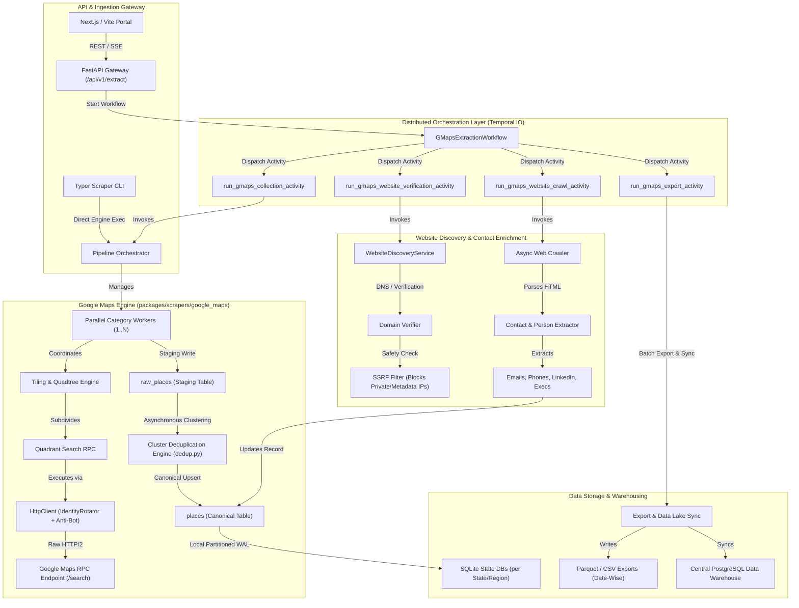
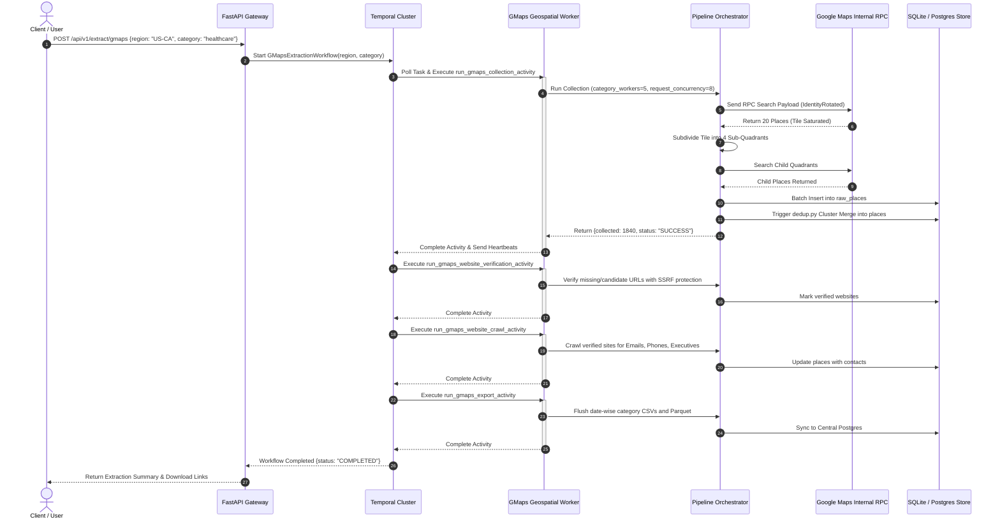

# Target Architecture: Google Maps Geospatial Extraction in OneExtraction

**Date**: November 1, 2026  
**Auditor**: Principal Software Architect & Staff Engineer  
**Scope**: Target Enterprise System Design for Geospatial Data Collection  

---

## 1. Architectural Vision & Principles

The integration of `G-Map-Scrapper` into `OneExtraction` unifies a high-throughput, low-level reverse-engineered RPC engine with an enterprise-grade distributed orchestration platform.

### Core Architecture Principles:
1. **Zero-API-Key Direct Protocol**: Bypasses costly external Google Places API billing by using internal RPC Protobuf payloads while staying compliant with rate and identity boundaries.
2. **Two-Tier Storage Topology**: Fast, crash-resilient regional SQLite databases in WAL mode during active quadrant scraping; asynchronous batch synchronization into central PostgreSQL and Parquet data lakes.
3. **Resilient Distributed Execution**: Temporal IO workflow orchestration provides deterministic retries, distributed leasing, state checkpointing, and horizontal scale across worker pools.
4. **Air-Gapped SSRF Hardening**: Website discovery and email enrichment enforce strict IP validation against RFC1918 and internal cloud metadata endpoints before issuing HTTP requests.

---

## 2. Component Diagram



---

## 3. End-to-End Data Flow

```mermaid
flowchart LR
    A["Target Region + Verticals"] --> B["Spatial Bounding Box & Geo Tiling"]
    B --> C["Quadrant Subdivision (Zoom 15..18)"]
    C --> D["Google Maps RPC Search Request"]
    D --> E["Raw Protobuf Response Parsing"]
    E --> F["Stage into raw_places Table"]
    F --> G["Cluster Deduplication (dedup.py)"]
    G --> H["Canonical places Table"]
    H --> I["Website Discovery & SSRF Verification"]
    I --> J["Multi-Page Contact Crawl (About/Contact)"]
    J --> K["Contact Normalization (E.164, Regex Clean)"]
    K --> L["Date-Wise CSV / Parquet / Postgres Sync"]
```



---

## 4. Execution Sequence Diagram (Temporal Distributed Flow)



---

## 5. Architectural Contracts & Interfaces

### 5.1. BaseScraper Adapter Contract
The wrapper at `packages/scrapers/google_maps/gmaps_scraper.py` must strictly adhere to `BaseScraper`:

```python
from packages.scrapers.base_scraper import BaseScraper
from typing import Dict, Any, Optional

class GMapsScraper(BaseScraper):
    def __init__(self):
        super().__init__(
            name="GMAPS_GEOSPATIAL",
            rate_limit_per_second=8.0,
            circuit_failure_threshold=5,
            circuit_cooldown_seconds=60.0,
        )

    def scrape(
        self,
        region: Optional[str] = None,
        vertical: Optional[str] = None,
        limit: Optional[int] = None,
        dry_run: bool = False,
    ) -> Dict[str, Any]:
        from gmaps_scraper.config import load_config
        from gmaps_scraper.db import Database
        from gmaps_scraper.orchestrator import PipelineOrchestrator, PipelineConfig

        cfg = load_config()
        db = Database(cfg.db_path)
        orchestrator = PipelineOrchestrator.get_instance(db, cfg)

        pipe_cfg = PipelineConfig(
            country="US",
            regions=[region] if region else None,
            categories=[vertical] if vertical else None,
            collection_limit=limit,
            dry_run=dry_run,
        )
        return orchestrator.run_pipeline(pipe_cfg)
```

### 5.2. Temporal Activity Execution Contract
The Temporal activity in `packages/temporal/activities/gmaps_activities.py` must execute the collection task loop with active heartbeats:

```python
@activity.defn(name="run_gmaps_collection")
async def run_gmaps_collection_activity(region: str, category: str, tile_config: dict) -> dict:
    activity.logger.info("Starting live GMaps collection: %s / %s", region, category)
    activity.heartbeat("Initializing pipeline engine")

    from gmaps_scraper.config import load_config
    from gmaps_scraper.db import Database
    from gmaps_scraper.orchestrator import PipelineOrchestrator, PipelineConfig

    cfg = load_config()
    db = Database(cfg.db_path)
    orchestrator = PipelineOrchestrator.get_instance(db, cfg)

    pipe_cfg = PipelineConfig(
        country=tile_config.get("country", "US"),
        regions=[region] if region else None,
        categories=[category] if category else None,
        collection_limit=tile_config.get("limit", None),
        category_workers=tile_config.get("category_workers", 3),
        request_concurrency=tile_config.get("request_concurrency", 5),
    )

    # Execute actual collection tasks with heartbeat
    result = await orchestrator.run_pipeline_async(pipe_cfg, heartbeat_fn=activity.heartbeat)
    return {
        "region": region,
        "category": category,
        "collected": result.get("total_unique", 0),
        "status": "SUCCESS",
    }
```

